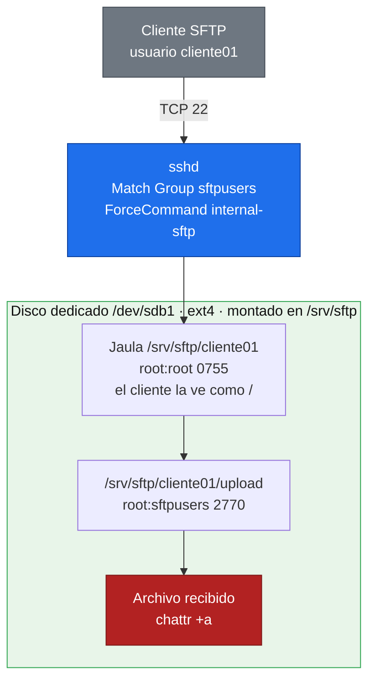
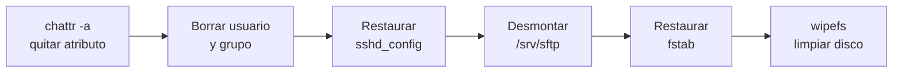

# Laboratorio: Disco Dedicado, Ext4 y Servidor SFTP Enjaulado


---

## Qué es este laboratorio

Este laboratorio lo uso para enseñar cómo se monta un punto de intercambio de archivos tal como se hace en una empresa: un cliente externo deja archivos en nuestro servidor por SFTP, sin poder ver nada más del sistema, y esos archivos quedan guardados en un disco que no es el del sistema operativo.

Al final de la práctica el servidor queda así:

- Un disco de 4 GB (`/dev/sdb`) particionado, formateado en `ext4` y montado de forma permanente en `/srv/sftp`.
- Un usuario `cliente01` que no tiene shell, solo SFTP, y que al conectarse ve como raíz (`/`) su propia carpeta.
- Una carpeta `upload` donde el cliente puede escribir, y una raíz de jaula donde no puede.
- Archivos recibidos protegidos a nivel de inodo con `chattr`, para que nadie los borre ni los sobrescriba por accidente.

## Para qué sirve

Cada pieza responde a un problema real que he visto en producción:

| Problema | Qué hacemos en el laboratorio |
|---|---|
| Un cliente sube 50 GB y llena `/`, el servidor deja de funcionar | Los datos van a un disco propio montado en `/srv/sftp` |
| El disco cambia de nombre (`sdb` pasa a `sdc`) y el servidor no arranca | Montamos por `UUID` y con la opción `nofail` |
| Un usuario de SFTP navega por `/etc` y lee configuración | Lo encerramos con `ChrootDirectory` |
| Un usuario de SFTP abre una shell o un túnel | `nologin`, `ForceCommand internal-sftp`, sin forwarding |
| Alguien borra un archivo que ya era evidencia o entrega formal | Atributo `append-only` en el inodo con `chattr +a` |

## Prerequisites

### Conocimientos

- Moverse por la terminal: `cd`, `ls`, `cat`, editar con `nano`.
- Saber qué son usuario, grupo y permisos `rwx`. El resto lo explico en el runbook.

### Entorno

| Recurso | Mínimo | Comentario |
|---|---|---|
| VMware Workstation, Player o ESXi | Cualquier versión actual | Necesitamos poder agregar un segundo disco |
| Ubuntu Server | 24.04 LTS | Instalación limpia, con red |
| CPU / RAM | 2 vCPU / 2 GB | Suficiente para el laboratorio |
| Disco del sistema | 20 GB | El que ya trae la VM |
| Disco adicional | 4 GB | Se agrega en la Fase 0, vacío |
| Usuario | Con permisos `sudo` | No trabajamos como `root` directo |

### Antes de la clase

Pido a cada estudiante que deje la VM instalada y actualizada, y que saque un **snapshot** llamado `base-limpia` antes de agregar el segundo disco. Ese snapshot es la forma más rápida de reiniciar el laboratorio.

## Estructura del repositorio

```text
lab-sftp-ext4/
├── README.md        Este archivo: contexto, requisitos y forma de uso
├── runbook.md       Procedimiento completo, fase por fase, con verificaciones
└── evidencias/      Lo crea cada estudiante: capturas y salidas de comandos
```

Los archivos que el laboratorio crea o modifica dentro del servidor no viven en el repositorio, viven en la VM:

```text
/
├── etc/
│   ├── fstab                     Se agrega la línea de montaje del disco SFTP
│   ├── fstab.pre-lab             Respaldo previo al laboratorio
│   └── ssh/
│       ├── sshd_config           Se agrega el bloque Match Group sftpusers
│       └── sshd_config.pre-lab   Respaldo previo al laboratorio
└── srv/
    └── sftp/                     Punto de montaje de /dev/sdb1 (root:root 0755)
        ├── lost+found/           Lo crea mkfs.ext4, no se toca
        └── cliente01/            Raíz de la jaula (root:root 0755)
            └── upload/           Zona de carga (root:sftpusers 2770)
```

## Vista general del flujo

El laboratorio avanza de lo más simple (comprobar herramientas) a lo más fino (atributos de inodo). Cada fase depende de la anterior, por eso no se saltan pasos.

```mermaid
flowchart LR
    F0["Fase 0<br/>Disco en VMware"] --> F1["Fase 1<br/>sudo y paquetes"]
    F1 --> F2["Fase 2<br/>Partición"]
    F2 --> F3["Fase 3<br/>Formato ext4"]
    F3 --> F4["Fase 4<br/>Montaje fstab"]
    F4 --> F5["Fase 5<br/>Usuario y jaula"]
    F5 --> F6["Fase 6<br/>sshd_config"]
    F6 --> F7["Fase 7<br/>Pruebas SFTP"]
    F7 --> F8["Fase 8<br/>chattr +a"]
    F8 -.-> F9["Fase 9<br/>Destrucción"]

    classDef storage fill:#2EA44F,stroke:#1a6b30,color:#fff
    classDef access fill:#1F6FEB,stroke:#0d419d,color:#fff
    classDef prep fill:#6E7781,stroke:#424a53,color:#fff
    classDef hard fill:#B22222,stroke:#7a1717,color:#fff
    class F0,F1 prep
    class F2,F3,F4 storage
    class F5,F6,F7 access
    class F8,F9 hard
```



Y así queda la arquitectura una vez terminado:



## Cómo se usa el runbook.md

El `runbook.md` está escrito para ejecutarse de arriba abajo, sin saltos. Cada paso tiene siempre la misma forma:

1. **Dónde:** en qué máquina y en qué directorio estoy parado.
2. **Comando:** listo para copiar.
3. **Qué hace:** el comando, cada opción, y cada archivo o directorio que toca.
4. **Verificación:** qué tengo que ver para dar el paso por bueno.

La regla que aplico en clase: **si la verificación no da lo esperado, no se avanza**. Casi todos los errores del laboratorio vienen de seguir adelante con un paso a medias (un disco sin montar, un permiso mal puesto) y descubrirlo tres fases después.

Sugerencia para los estudiantes: guardar en `evidencias/` la salida de cada verificación, numerada por fase. Así la revisión es rápida y el informe se arma solo.

Las fases se agrupan en cuatro momentos:

| Momento | Fases | Resultado |
|---|---|---|
| Preparar | 0 y 1 | VM con disco extra y herramientas instaladas |
| Levantar | 2, 3, 4, 5 y 6 | Disco montado, usuario creado, sshd configurado |
| Cargar | 7 | Archivo subido por SFTP dentro de la jaula |
| Acceder y proteger | 7 y 8 | Acceso comprobado y archivo blindado con `chattr` |

## Cómo destruir y volver a reproducir el laboratorio

Hay dos caminos, según cuánto tiempo tenga.

### Opción A: snapshot de VMware (la rápida)

1. Apagar la VM.
2. Revertir al snapshot `base-limpia`.
3. Eliminar el disco adicional desde la configuración de la VM y agregar uno nuevo de 4 GB.
4. Empezar el runbook desde la Fase 0.

### Opción B: desmontaje manual (la que enseña)

Es la Fase 9 del runbook. Deshace todo en orden inverso al que se construyó:



El orden importa: si intento desmontar el disco con el atributo `a` todavía activo no pasa nada grave, pero si borro carpetas antes de quitarlo, el borrado falla. Y si restauro `fstab` antes de desmontar, el sistema queda con un montaje que ya no está declarado.

Después de la Fase 9 el disco queda vacío, sin firma, igual que recién agregado. Para reproducir el laboratorio se vuelve a la Fase 2.

---

Material de clase. Probado sobre Ubuntu Server 24.04 LTS en VMware Workstation.

