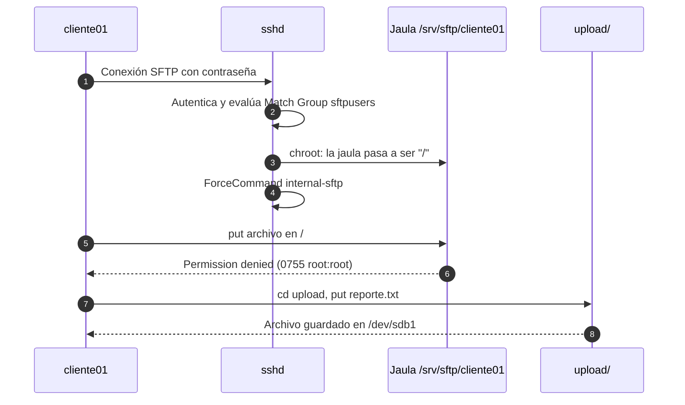

# Runbook: Disco Dedicado, Ext4 y Servidor SFTP Enjaulado


Este es el procedimiento que sigo en clase, en el orden exacto en que se ejecuta. Cada paso tiene cuatro partes: dónde estoy, qué ejecuto, qué hace cada pieza y cómo compruebo que salió bien. Si una verificación falla, me detengo ahí y lo resuelvo antes de seguir.

Convenciones del documento:

- `$` al inicio de una salida de ejemplo indica el prompt; los bloques de comandos se copian sin él.
- **Dónde** indica la máquina y el directorio de trabajo.
- Uso `/dev/sdb` como disco de laboratorio. Si en tu VM aparece con otra letra, la cambias en todos los comandos.

---

## Índice

| Fase | Tema | Momento |
|---|---|---|
| 0 | Agregar el disco en VMware | Preparar |
| 1 | Acceso `sudo` y paquetes | Preparar |
| 2 | Identificar y particionar `/dev/sdb` | Levantar |
| 3 | Formatear en `ext4` | Levantar |
| 4 | Montaje persistente en `/srv/sftp` | Levantar |
| 5 | Grupo, usuario y estructura de jaula | Levantar |
| 6 | Configurar OpenSSH | Levantar |
| 7 | Pruebas de acceso y carga | Cargar y acceder |
| 8 | Hardening de inodo con `chattr` | Proteger |
| 9 | Destrucción del laboratorio | Reiniciar |

---

## Fase 0: Agregar el disco adicional en VMware

**Dónde:** consola de VMware, con la VM apagada.

En esta fase no hay comandos. Le damos a la VM un segundo disco físico (virtual) que va a ser exclusivo para SFTP.

1. Con la VM apagada, crear un snapshot llamado `base-limpia`. Es mi punto de retorno si algo sale mal.
2. Abrir **Settings** (o **Edit Settings** en ESXi) de la VM.
3. **Add > Hard Disk**, tipo **SCSI** o **NVMe** (el que proponga VMware), **Create a new virtual disk**, tamaño **4 GB**.
4. Guardar y encender la VM.

Por qué un disco aparte y no una carpeta en `/`: si un cliente sube más datos de los previstos, se llena ese disco y el sistema operativo sigue funcionando. Con todo en `/`, se cae el servidor entero.

**Verificación:** la VM arranca normalmente. La presencia del disco la comprobamos en la Fase 2.

---

## Fase 1: Acceso administrativo y herramientas

**Dónde:** consola de la VM, como tu usuario normal, en tu carpeta personal (`~`).

### 1.1 Validar `sudo`

```bash
sudo -v
```

- `sudo`: ejecuta lo que sigue con privilegios de administrador, si tu usuario pertenece al grupo `sudo`.
- `-v` (`--validate`): no ejecuta ningún comando; solo pide la contraseña y renueva el tiempo durante el cual `sudo` no la vuelve a pedir (15 minutos por defecto).

**Verificación:** el prompt vuelve sin mensajes. Si aparece `is not in the sudoers file`, el usuario no tiene permisos y el laboratorio no se puede hacer con esa cuenta.

### 1.2 Actualizar el índice e instalar paquetes

```bash
sudo apt update
sudo apt install -y openssh-server e2fsprogs util-linux parted
```

- `apt update`: descarga la lista actualizada de paquetes desde los repositorios configurados en `/etc/apt/sources.list.d/`. No instala nada.
- `apt install`: instala los paquetes indicados.
- `-y`: responde "sí" automáticamente a la confirmación.
- `openssh-server`: trae el demonio `sshd` y el subsistema `internal-sftp` que usaremos para la jaula.
- `e2fsprogs`: herramientas de ext2/3/4: `mkfs.ext4`, `chattr`, `lsattr`, `tune2fs`.
- `util-linux`: herramientas de bloque y montaje: `lsblk`, `blkid`, `mount`, `umount`, `fdisk`, `wipefs`, `findmnt`.
- `parted`: aporta `partprobe`, que usaremos para avisarle al kernel de la nueva partición. No viene en `util-linux`, por eso lo instalo aparte.

En una instalación de Ubuntu Server casi todo ya está presente; `apt` lo indica con `is already the newest version` y sigue.

### 1.3 Comprobar el servicio SSH

```bash
systemctl status ssh --no-pager
systemctl is-active ssh.socket
```

- `systemctl status ssh`: muestra el estado de la unidad `ssh.service`.
- `--no-pager`: imprime todo de una vez, sin abrir el visor `less`.
- `systemctl is-active ssh.socket`: en Ubuntu 24.04 SSH arranca por **activación por socket**: systemd escucha el puerto 22 y levanta `sshd` cuando llega la primera conexión. Por eso `ssh.service` puede aparecer `inactive` sin que haya un problema.

**Verificación:** `ssh.socket` devuelve `active`, o `ssh.service` aparece `active (running)`. Con cualquiera de los dos, el servidor acepta conexiones.

---

## Fase 2: Identificar y particionar el disco

**Dónde:** consola de la VM, cualquier directorio.

### 2.1 Identificar el disco nuevo

```bash
lsblk -o NAME,SIZE,TYPE,FSTYPE,MOUNTPOINTS
```

- `lsblk`: lista los dispositivos de bloque (discos y particiones) en forma de árbol.
- `-o`: elige qué columnas mostrar.
  - `NAME`: nombre del dispositivo (`sda`, `sdb`, `sdb1`).
  - `SIZE`: tamaño.
  - `TYPE`: `disk` para discos completos, `part` para particiones, `lvm` para volúmenes lógicos.
  - `FSTYPE`: sistema de archivos, vacío si no tiene.
  - `MOUNTPOINTS`: dónde está montado.

Salida esperada (aproximada):

```text
NAME                      SIZE TYPE FSTYPE      MOUNTPOINTS
sda                        20G disk
├─sda1                      1M part
├─sda2                      2G part ext4        /boot
└─sda3                     18G part LVM2_member
  └─ubuntu--vg-ubuntu--lv  10G lvm  ext4        /
sdb                         4G disk
```

**Verificación:** veo un disco de 4 GB, sin hijos, sin `FSTYPE` y sin punto de montaje. Ese es el disco del laboratorio. El disco que contiene `/` no se toca bajo ninguna circunstancia; si `fdisk` se ejecuta sobre él, la VM queda inservible.

### 2.2 Crear la tabla de particiones y la partición

```bash
sudo fdisk /dev/sdb
```

- `fdisk`: editor interactivo de tablas de particiones. Los cambios quedan en memoria hasta que se escribe `w`, así que mientras no presione `w` puedo salir con `q` sin consecuencias.
- `/dev/sdb`: el archivo de dispositivo que representa el disco completo. En Linux los discos son archivos dentro de `/dev`.

Secuencia de teclas dentro de `fdisk`:

| Tecla | Acción |
|---|---|
| `o` | Crea una tabla de particiones nueva tipo DOS (MBR). Para un disco de 4 GB alcanza de sobra; GPT se usaría con `g` en discos mayores de 2 TB o con arranque UEFI. |
| `n` | Nueva partición. |
| `p` | Partición primaria. |
| `1` | Número de partición: será `/dev/sdb1`. |
| `Enter` | Sector inicial por defecto (2048, alineado para buen rendimiento). |
| `Enter` | Sector final por defecto: ocupa todo el disco. |
| `p` | Imprime la tabla para revisarla antes de guardar. |
| `w` | Escribe la tabla en el disco y sale. |

### 2.3 Avisar al kernel

```bash
sudo partprobe /dev/sdb
```

- `partprobe`: pide al kernel que vuelva a leer la tabla de particiones del disco indicado, sin reiniciar. Normalmente `fdisk` ya lo consigue al escribir, pero lo ejecuto igual para no depender de eso.

**Verificación:**

```bash
lsblk /dev/sdb
```

Debe aparecer `sdb1` como hijo de `sdb`, de tipo `part` y unos 4 GB.

---

## Fase 3: Formatear en ext4

**Dónde:** consola de la VM, cualquier directorio.

Una partición es solo un rango de sectores. Para guardar archivos le falta un **sistema de archivos**: la estructura que organiza inodos, directorios y bloques.

```bash
sudo mkfs.ext4 -L SFTP_DATA /dev/sdb1
```

- `mkfs.ext4`: crea un sistema de archivos ext4. Borra lo que hubiera en la partición.
- `-L SFTP_DATA`: le pone la etiqueta `SFTP_DATA`. Sirve para reconocerlo de un vistazo en `lsblk -f` y `blkid`.
- `/dev/sdb1`: la partición a formatear. Ojo: la partición (`sdb1`), no el disco (`sdb`).

Por qué ext4 para este caso:

- **Journaling:** si la VM se apaga a mitad de una subida, el sistema de archivos se recupera de forma consistente al arrancar.
- **Atributos de inodo:** soporta `chattr +a` y `chattr +i`, que usamos en la Fase 8.
- **Madurez:** es el sistema por defecto de Ubuntu, con herramientas de reparación (`fsck.ext4`) incluidas.

`mkfs.ext4` crea en la raíz el directorio `lost+found`, donde `fsck` deja fragmentos recuperados tras una corrupción. No se borra.

**Verificación:**

```bash
lsblk -f /dev/sdb
```

- `-f`: muestra columnas de filesystem (`FSTYPE`, `LABEL`, `UUID`).

`sdb1` debe mostrar `FSTYPE` = `ext4` y `LABEL` = `SFTP_DATA`.

---

## Fase 4: Montaje persistente en /srv/sftp

**Dónde:** consola de la VM, cualquier directorio.

Un sistema de archivos se usa cuando se **monta**: se engancha a un directorio del árbol. Si solo uso `mount`, el montaje se pierde al reiniciar. Para que sea permanente se declara en `/etc/fstab`.

### 4.1 Crear el punto de montaje

```bash
sudo mkdir -p /srv/sftp
```

- `mkdir`: crea directorios.
- `-p`: crea los directorios intermedios si faltan y no da error si ya existe.
- `/srv/sftp`: según el estándar FHS, `/srv` guarda datos que el servidor entrega a otros (web, FTP, SFTP). Es el lugar correcto.

### 4.2 Respaldar /etc/fstab

```bash
sudo cp /etc/fstab /etc/fstab.pre-lab
```

- `/etc/fstab`: tabla de sistemas de archivos que se montan al arrancar. Un error aquí puede impedir que la VM arranque, por eso siempre respaldo antes.
- `/etc/fstab.pre-lab`: uso un nombre fijo (no una fecha) para encontrarlo sin dudas en la Fase 9.

### 4.3 Obtener el UUID

```bash
sudo blkid -s UUID -o value /dev/sdb1
```

- `blkid`: muestra los identificadores de un dispositivo de bloque.
- `-s UUID`: solo la etiqueta `UUID`.
- `-o value`: solo el valor, sin `UUID="..."` alrededor.

Monto por UUID y no por `/dev/sdb1` porque el nombre `sdb` lo asigna el kernel según el orden en que detecta los discos. Si mañana agrego otro disco, `sdb` puede pasar a llamarse `sdc`. El UUID se grabó dentro del sistema de archivos al formatear y no cambia.

### 4.4 Agregar la línea a /etc/fstab

```bash
echo "UUID=$(sudo blkid -s UUID -o value /dev/sdb1)  /srv/sftp  ext4  defaults,nodev,nosuid,noexec,nofail  0  2" | sudo tee -a /etc/fstab
```

- `echo "..."`: imprime la línea de texto.
- `$( ... )`: sustitución de comando: Bash ejecuta lo de adentro y pone su salida en ese lugar. Así el UUID real entra directo en la línea, sin copiarlo a mano.
- `|`: pasa la salida de `echo` como entrada al siguiente comando.
- `sudo tee -a /etc/fstab`: `tee` escribe lo que recibe en el archivo y además lo muestra en pantalla. `-a` agrega al final en vez de sobrescribir. Uso `sudo tee` porque `sudo echo ... >> /etc/fstab` no funciona: la redirección `>>` la hace mi shell sin privilegios, no `sudo`.

Las seis columnas de la línea:

| Columna | Valor | Significado |
|---|---|---|
| 1 | `UUID=...` | Qué se monta |
| 2 | `/srv/sftp` | Dónde se monta |
| 3 | `ext4` | Tipo de sistema de archivos |
| 4 | `defaults,nodev,nosuid,noexec,nofail` | Opciones de montaje |
| 5 | `0` | `dump`: no se respalda con la utilidad `dump` |
| 6 | `2` | Orden de `fsck` al arrancar: `1` es la raíz, `2` cualquier otro |

Opciones de montaje, una por una:

- `defaults`: `rw,suid,dev,exec,auto,nouser,async`. Es la base; las opciones que siguen sobrescriben parte de ella.
- `nodev`: no interpreta archivos de dispositivo dentro de este disco. Un usuario no puede subir un `/dev/sda` falso y usarlo.
- `nosuid`: ignora los bits SUID y SGID de ejecutables. Un binario subido no puede escalar privilegios. No afecta al setgid de directorios que usamos en la Fase 5.
- `noexec`: no permite ejecutar programas desde este disco. Aquí solo se guardan datos.
- `nofail`: si el disco no está al arrancar, el sistema arranca igual y registra el error. Sin esto, un disco ausente deja la VM en modo de emergencia.

### 4.5 Revisar fstab y montar

```bash
sudo findmnt --verify
sudo systemctl daemon-reload
sudo mount -a
```

- `findmnt --verify`: revisa la sintaxis de `/etc/fstab` y que los dispositivos existan. Si reporta errores, corrijo con `sudo nano /etc/fstab` antes de seguir.
- `systemctl daemon-reload`: en Ubuntu, systemd convierte cada línea de `fstab` en una unidad `.mount`. Este comando hace que lea el archivo modificado.
- `mount -a`: monta todo lo declarado en `fstab` que todavía no esté montado. Si la línea está mal, falla aquí y no en el próximo arranque.

**Verificación:**

```bash
findmnt /srv/sftp
df -hT /srv/sftp
```

- `findmnt /srv/sftp`: muestra origen, tipo y opciones del montaje. Debe aparecer `/dev/sdb1`, `ext4` y en `OPTIONS` las palabras `nosuid,nodev,noexec`.
- `df -hT`: espacio usado y libre. `-h` en unidades legibles (G, M), `-T` muestra el tipo. Debe mostrar unos 3,9 GB de tamaño, tipo `ext4`.

---

## Fase 5: Grupo, usuario y estructura de la jaula

**Dónde:** consola de la VM, cualquier directorio.

Antes de los comandos, la regla que manda en esta fase. Para que OpenSSH acepte encerrar a un usuario con `ChrootDirectory`, **cada directorio de la ruta hasta la jaula, incluida la jaula, debe pertenecer a `root` y no tener escritura para el grupo ni para otros**. Si cualquiera falla, el usuario no puede entrar y en el log aparece `bad ownership or modes for chroot directory`.

En nuestro caso esa ruta es `/`, `/srv`, `/srv/sftp` y `/srv/sftp/cliente01`. Los dos primeros ya cumplen en una instalación estándar. Los otros dos los dejamos bien en esta fase.

Consecuencia práctica: el usuario no puede escribir en la raíz de su jaula. Por eso le damos una subcarpeta `upload` donde sí puede.

### 5.1 Crear el grupo

```bash
sudo groupadd sftpusers
```

- `groupadd`: crea un grupo nuevo en `/etc/group`.
- `sftpusers`: todo usuario de este grupo recibirá la política SFTP. Para agregar un cliente nuevo mañana, basta con meterlo al grupo.

### 5.2 Crear el usuario

```bash
sudo useradd -M -d /srv/sftp/cliente01 -s /usr/sbin/nologin -G sftpusers cliente01
```

- `useradd`: crea el usuario en `/etc/passwd` y `/etc/shadow`.
- `-M`: **no** crea el directorio personal. Lo creo yo a mano en 5.4 con el dueño correcto. Si usara `-m`, `useradd` lo crearía con dueño `cliente01` y copiaría `.bashrc` y otros archivos de `/etc/skel`, que habría que limpiar después.
- `-d /srv/sftp/cliente01`: directorio personal registrado del usuario. `sshd` lo usará como base de la jaula.
- `-s /usr/sbin/nologin`: shell que rechaza el acceso interactivo. Si alguien intenta abrir una sesión de terminal, recibe un mensaje y se desconecta.
- `-G sftpusers`: agrega el usuario al grupo secundario `sftpusers`. El grupo primario será `cliente01`, creado automáticamente.

### 5.3 Asignar contraseña

```bash
sudo passwd cliente01
```

- `passwd`: define la contraseña. La pide dos veces y la guarda cifrada en `/etc/shadow`.

**Verificación de 5.1 a 5.3:**

```bash
id cliente01
getent passwd cliente01
```

- `id`: muestra UID, GID y grupos. Debe incluir `sftpusers`.
- `getent passwd`: muestra la línea del usuario. Los dos últimos campos deben ser `/srv/sftp/cliente01` y `/usr/sbin/nologin`.

### 5.4 Construir la jaula y la zona de carga

```bash
sudo mkdir -p /srv/sftp/cliente01/upload
sudo chown root:root /srv/sftp /srv/sftp/cliente01
sudo chmod 0755 /srv/sftp /srv/sftp/cliente01
sudo chown root:sftpusers /srv/sftp/cliente01/upload
sudo chmod 2770 /srv/sftp/cliente01/upload
```

- `mkdir -p /srv/sftp/cliente01/upload`: crea la jaula y, dentro, la zona de carga, en un solo paso.
- `chown root:root`: cambia dueño y grupo. Formato `usuario:grupo`.
- `chmod 0755`: permisos en octal. Cada dígito es la suma de `r=4`, `w=2`, `x=1`.

Permisos de la jaula `/srv/sftp` y `/srv/sftp/cliente01`, `root:root 0755`:

| Dígito | Para | Valor | Permisos |
|---|---|---|---|
| `0` | Bits especiales | ninguno | |
| `7` | Dueño `root` | 4+2+1 | `rwx` |
| `5` | Grupo `root` | 4+1 | `r-x` |
| `5` | Otros | 4+1 | `r-x` |

`cliente01` entra en la jaula y lista su contenido como "otros", pero no puede crear ni borrar nada en ella. Es exactamente lo que exige `ChrootDirectory`.

Permisos de la zona de carga `/srv/sftp/cliente01/upload`, `root:sftpusers 2770`:

| Dígito | Para | Valor | Permisos |
|---|---|---|---|
| `2` | Bits especiales | setgid | `s` en el grupo |
| `7` | Dueño `root` | 4+2+1 | `rwx` |
| `7` | Grupo `sftpusers` | 4+2+1 | `rwx` |
| `0` | Otros | 0 | `---` |

- **setgid en un directorio**: todo archivo creado adentro hereda el grupo del directorio (`sftpusers`) en lugar del grupo primario de quien lo crea. Así el equipo de operaciones, si está en `sftpusers`, puede leer lo que suben los clientes sin cambiar permisos a mano.
- **`7` al grupo**: `cliente01` escribe aquí por ser miembro de `sftpusers`.
- **`0` a otros**: ningún usuario fuera del grupo puede ni siquiera listar la carpeta.

**Verificación:**

```bash
ls -ld /srv/sftp /srv/sftp/cliente01 /srv/sftp/cliente01/upload
```

- `ls -l`: formato largo con permisos, dueño y grupo.
- `-d`: muestra el directorio en sí, no su contenido.

Salida esperada:

```text
drwxr-xr-x 4 root root      4096 ... /srv/sftp
drwxr-xr-x 3 root root      4096 ... /srv/sftp/cliente01
drwxrws--- 2 root sftpusers 4096 ... /srv/sftp/cliente01/upload
```

La `s` en `rws` del grupo confirma el setgid.

---

## Fase 6: Configurar OpenSSH

**Dónde:** consola de la VM, cualquier directorio. Archivo: `/etc/ssh/sshd_config`.

Este diagrama muestra lo que va a pasar cuando `cliente01` se conecte, una vez terminada esta fase:



### 6.1 Respaldar la configuración

```bash
sudo cp /etc/ssh/sshd_config /etc/ssh/sshd_config.pre-lab
```

- `/etc/ssh/sshd_config`: configuración del servidor SSH. Si queda mal y reinicio el servicio, puedo perder el acceso remoto a la VM; por eso trabajo desde la consola de VMware y con respaldo.

### 6.2 Agregar el bloque de la jaula al final del archivo

```bash
sudo tee -a /etc/ssh/sshd_config > /dev/null <<'EOF'

# --- Laboratorio SFTP: jaula para el grupo sftpusers ---
Match Group sftpusers
    ChrootDirectory /srv/sftp/%u
    ForceCommand internal-sftp
    AllowTcpForwarding no
    X11Forwarding no
    PermitTunnel no
EOF
```

Cómo se construye el comando:

- `<<'EOF' ... EOF`: *here-document*. Todo lo que está entre las dos marcas se envía como entrada al comando. Las comillas en `'EOF'` impiden que Bash interprete `%u` u otros símbolos.
- `sudo tee -a /etc/ssh/sshd_config`: agrega ese texto al final del archivo con privilegios.
- `> /dev/null`: descarta la copia que `tee` imprime en pantalla.

Por qué al **final**: un bloque `Match` afecta a todas las líneas que vienen después, hasta el siguiente `Match` o el fin del archivo. Si lo pongo al medio, las directivas globales que lo siguen quedarían aplicadas solo a `sftpusers`.

Qué hace cada directiva:

- `Match Group sftpusers`: las líneas siguientes valen solo para miembros de `sftpusers`. Mi usuario administrador sigue entrando por SSH normal.
- `ChrootDirectory /srv/sftp/%u`: tras autenticar, `sshd` encierra la sesión en esa ruta. `%u` se reemplaza por el nombre del usuario, así un solo bloque sirve para `cliente01`, `cliente02` y los que vengan.
- `ForceCommand internal-sftp`: ignora lo que pida el cliente y ejecuta siempre el servidor SFTP interno de `sshd`. Uso `internal-sftp` y no `/usr/lib/openssh/sftp-server` porque el segundo es un binario externo que tendría que existir dentro de la jaula, junto con sus librerías.
- `AllowTcpForwarding no`: impide usar la conexión como túnel hacia otros puertos o máquinas.
- `X11Forwarding no`: impide redirigir aplicaciones gráficas.
- `PermitTunnel no`: impide crear interfaces de red tipo VPN sobre SSH.

### 6.3 Validar antes de reiniciar

```bash
sudo sshd -t
```

- `sshd -t`: modo test. Lee la configuración, informa errores y termina sin tocar el servicio en ejecución. Si no imprime nada, la sintaxis es válida.

Si aparece `Missing privilege separation directory: /run/sshd`, es por la activación por socket de Ubuntu 24.04: el directorio se crea cuando el servicio arranca. Lo resuelvo con `sudo mkdir -p /run/sshd` y repito `sudo sshd -t`.

Compruebo además que la regla aplica al usuario correcto:

```bash
sudo sshd -T -C user=cliente01,host=localhost,addr=127.0.0.1 | grep -Ei 'chrootdirectory|forcecommand|passwordauthentication'
```

- `sshd -T`: imprime la configuración efectiva completa, ya resuelta.
- `-C user=...,host=...,addr=...`: simula una conexión con esos datos, para que se evalúen los bloques `Match`.
- `grep -Ei`: filtra las líneas que me interesan. `-E` permite usar `|` como "o", `-i` ignora mayúsculas.

Debo ver `chrootdirectory /srv/sftp/cliente01`, `forcecommand internal-sftp` y `passwordauthentication yes`. Si esta última dice `no`, hay un archivo en `/etc/ssh/sshd_config.d/` que desactiva contraseñas (en VMs creadas con cloud-init suele ser `50-cloud-init.conf`). Para el laboratorio lo reviso con `sudo grep -r PasswordAuthentication /etc/ssh/sshd_config.d/` y cambio el valor a `yes`.

### 6.4 Aplicar los cambios

```bash
sudo systemctl restart ssh
```

- `systemctl restart ssh`: detiene y vuelve a levantar `sshd` con la configuración nueva. Las sesiones SSH ya abiertas no se cortan.

**Verificación:**

```bash
systemctl status ssh --no-pager
```

Debe aparecer `active (running)` y ninguna línea de error en el resumen del log.

---

## Fase 7: Pruebas de acceso y carga

**Dónde:** consola de la VM. Me conecto a `localhost`, así la VM hace de servidor y de cliente al mismo tiempo. Desde otra máquina el procedimiento es idéntico cambiando `localhost` por la IP de la VM (`ip -br addr` la muestra).

### 7.1 Preparar un archivo de prueba

```bash
cd ~
echo "datos confidenciales del cliente" > reporte.txt
```

- `cd ~`: me ubica en mi carpeta personal. Es importante porque `sftp put` busca el archivo en el directorio local desde donde inicié `sftp`.
- `echo "..." > reporte.txt`: crea el archivo con ese texto. `>` sobrescribe si ya existe.

### 7.2 Comprobar que no hay shell

```bash
ssh cliente01@localhost
```

- `ssh usuario@host`: intenta abrir una sesión interactiva.

**Verificación:** tras la contraseña, aparece `This service allows sftp connections only.` y la conexión se cierra. `ForceCommand` está funcionando. La primera vez SSH pregunta si confío en la huella del servidor; respondo `yes`.

### 7.3 Entrar por SFTP y revisar la jaula

```bash
sftp cliente01@localhost
```

Dentro del prompt `sftp>`:

```text
pwd
ls -la
```

- `pwd`: directorio remoto actual. Debe responder `/`. Para `cliente01` la raíz del sistema es su jaula.
- `ls -la`: lista el contenido remoto, incluidos ocultos. Debo ver solo `upload`. Nada de `etc`, `home` ni `usr`.

### 7.4 Comprobar que la raíz de la jaula es de solo lectura

```text
put reporte.txt
```

**Verificación:** responde con `Permission denied`. Es el `0755 root:root` de la Fase 5 haciendo su trabajo.

### 7.5 Cargar en la zona de upload

```text
cd upload
put reporte.txt
ls -la
exit
```

- `cd upload`: entra en la zona con escritura.
- `put reporte.txt`: sube el archivo local al directorio remoto actual.
- `ls -la`: confirma que el archivo está.
- `exit`: cierra la sesión SFTP.

### 7.6 Verificar desde el servidor

```bash
sudo ls -l /srv/sftp/cliente01/upload/
df -h /srv/sftp
```

**Verificación:** `reporte.txt` aparece con dueño `cliente01` y grupo `sftpusers`. El grupo heredado demuestra que el setgid funciona. `df` confirma que el archivo vive en `/dev/sdb1` y no en el disco del sistema.

Si alguna prueba falla, el primer lugar donde miro es el log de autenticación:

```bash
sudo journalctl -u ssh -n 30 --no-pager
```

- `journalctl -u ssh`: mensajes de la unidad `ssh`.
- `-n 30`: solo las últimas 30 líneas.

El error más común es `bad ownership or modes for chroot directory`, y se corrige repitiendo los `chown`/`chmod` de la Fase 5.4.

---

## Fase 8: Hardening de inodo con chattr

**Dónde:** consola de la VM, como administrador.

Hoy `cliente01` puede borrar o sobrescribir lo que subió, porque tiene escritura sobre `upload`. Cuando un archivo ya fue recibido y tiene valor (una entrega, una evidencia, un respaldo), quiero que eso no sea posible.

Los permisos `rwx` no alcanzan para esto: borrar un archivo depende del permiso de escritura en el **directorio**, no en el archivo. Por eso bajo un nivel, al **inodo**: la estructura de ext4 que guarda los metadatos de cada archivo. Ahí existen atributos que el kernel respeta por encima de los permisos y que afectan incluso a `root`.

### 8.1 Activar append-only

```bash
sudo chattr +a /srv/sftp/cliente01/upload/reporte.txt
```

- `chattr`: cambia atributos de inodo en ext2/3/4.
- `+a`: activa el atributo *append-only*. Con él activo, el archivo:
  - no se puede borrar,
  - no se puede renombrar ni mover,
  - no se puede truncar ni sobrescribir,
  - **sí** acepta que se agreguen datos al final.

Solo `root` puede poner o quitar este atributo (requiere la capacidad `CAP_LINUX_IMMUTABLE`). Mientras esté puesto, ni `root` puede borrar el archivo sin quitarlo primero.

Si necesito que tampoco se pueda agregar contenido, uso `chattr +i` (*immutable*): el archivo queda congelado por completo. Para archivos de log conviene `+a`; para entregas cerradas, `+i`.

### 8.2 Verificar el atributo

```bash
lsattr /srv/sftp/cliente01/upload/reporte.txt
```

- `lsattr`: lista los atributos de inodo.

Salida esperada:

```text
-----a--------e------- /srv/sftp/cliente01/upload/reporte.txt
```

- `a`: append-only, el que acabo de poner.
- `e`: *extents*, lo pone ext4 de forma automática en todos los archivos. Indica cómo se mapean los bloques en el disco. No lo toco.

### 8.3 Comprobar la protección desde el cliente

```bash
sftp cliente01@localhost
```

```text
cd upload
rm reporte.txt
rename reporte.txt otro.txt
put reporte.txt
exit
```

**Verificación:** las tres operaciones (`rm`, `rename` y `put`, que intenta sobrescribir) responden con `Permission denied` o `Failure`. Desde el servidor, `sudo rm /srv/sftp/cliente01/upload/reporte.txt` responde `Operation not permitted`: ni `root` lo borra sin quitar antes el atributo.

---

## Fase 9: Destrucción del laboratorio

**Dónde:** consola de la VM. Se ejecuta en este orden, que es el inverso de la construcción.

### 9.1 Quitar los atributos de inodo

```bash
sudo chattr -R -a -i /srv/sftp/cliente01/upload
```

- `-R`: recorre el directorio y todo su contenido.
- `-a -i`: quita append-only e immutable, por si probé alguno de los dos.

Sin esto, el borrado de la carpeta en 9.2 falla.

### 9.2 Borrar usuario, grupo y datos

```bash
sudo userdel cliente01
sudo groupdel sftpusers
sudo rm -rf /srv/sftp/cliente01
```

- `userdel`: elimina el usuario de `/etc/passwd`, `/etc/shadow` y su grupo primario. No uso `-r` porque el directorio personal es de `root` y lo borro aparte.
- `groupdel`: elimina el grupo `sftpusers`.
- `rm -rf`: borra la jaula de forma recursiva (`-r`) sin pedir confirmación (`-f`). Reviso la ruta dos veces antes de presionar Enter.

### 9.3 Restaurar sshd_config

```bash
sudo cp /etc/ssh/sshd_config.pre-lab /etc/ssh/sshd_config
sudo sshd -t
sudo systemctl restart ssh
```

Devuelve el archivo al estado anterior, lo valida y aplica.

### 9.4 Desmontar y restaurar fstab

```bash
sudo umount /srv/sftp
sudo cp /etc/fstab.pre-lab /etc/fstab
sudo systemctl daemon-reload
sudo rmdir /srv/sftp
```

- `umount`: desengancha el disco del árbol. Si responde `target is busy`, alguna terminal está parada dentro de `/srv/sftp`; salgo con `cd ~` y repito.
- `cp ... /etc/fstab`: deja `fstab` como estaba antes del laboratorio.
- `daemon-reload`: systemd olvida la unidad de montaje.
- `rmdir`: borra el punto de montaje, que ahora es un directorio vacío del disco del sistema.

### 9.5 Limpiar el disco

```bash
sudo wipefs -a /dev/sdb1
sudo wipefs -a /dev/sdb
```

- `wipefs`: borra las firmas que identifican un sistema de archivos o una tabla de particiones.
- `-a`: todas las firmas encontradas.
- Primero la partición (firma ext4) y después el disco (tabla MBR).

**Verificación final:**

```bash
lsblk -f /dev/sdb
id cliente01
findmnt /srv/sftp
```

- `lsblk -f`: `sdb` aparece sin hijos y sin `FSTYPE`, como en la Fase 2.1.
- `id cliente01`: `no such user`.
- `findmnt /srv/sftp`: no devuelve nada.

Con esto la VM queda lista para repetir el laboratorio desde la Fase 2.

