# Laboratorio de Administración de Almacenamiento y Sistemas de Archivos en Linux


Este es el laboratorio que uso para enseñar administración de almacenamiento en Linux, de principio a fin y sin LVM. Todo ocurre sobre un disco virtual vacío (`/dev/sdb`) dentro de una máquina virtual Ubuntu 24.04 LTS en VMware. El disco empieza sin nada y termina particionado, formateado, montado de forma persistente, medido, deteriorado a propósito y reparado.

El orden va de lo simple a lo complejo. Primero miramos el disco, después lo partimos, le damos formato, lo montamos y lo llenamos. Con datos reales medimos, ajustamos y rompemos cosas, y al final reparamos. Cada comando queda explicado en `runbook.md`: qué hace, qué significa cada opción y cada argumento, qué archivo toca y por qué lo usamos.

## Para qué sirve

Sirve para que quien lo complete pueda enfrentarse a un servidor Linux con un disco nuevo y dejarlo operativo, y para que pueda diagnosticar y reparar el disco cuando falle. Todo se hace con las herramientas que existen en cualquier servidor, más unas pocas utilidades de análisis que conviene tener instaladas.

## Alcance

Entra todo lo que tiene que ver con disco, particiones y sistemas de archivos:

* Inventario y estado del hardware de almacenamiento.
* Tablas de particiones MBR (particiones primarias, extendida y lógicas) y GPT.
* Sistemas de archivos ext2, ext3, ext4 y XFS, con sus diferencias reales.
* Inodos y punteros directos, indirectos, dobles y triples.
* Montaje, desmontaje, opciones de montaje y persistencia en `/etc/fstab`.
* Consumo de espacio y de inodos, y carga de datos de prueba.
* Rendimiento de entrada y salida, y su medición.
* Ajuste fino, conversión entre sistemas de archivos y ampliación sin LVM.
* Resolución de fallas: disco lleno, inodos agotados, archivos borrados que siguen abiertos, modo solo lectura, superbloque dañado.
* Reparación con `fsck` y `xfs_repair`.

Queda fuera LVM, RAID, cifrado, cuotas, NFS y almacenamiento en red.

## Qué vas a aprender

| Capacidad | Qué vas a dominar | Herramientas principales |
|---|---|---|
| Descubrir | Leer la topología de bloques y el estado del disco | `lsblk`, `blkid`, `fdisk -l`, `udevadm`, `smartctl`, `/proc`, `/sys` |
| Particionar | Crear, respaldar y restaurar tablas MBR y GPT | `fdisk`, `sfdisk`, `parted`, `sgdisk`, `partprobe`, `partx` |
| Dar formato | Elegir y crear el sistema de archivos correcto | `mkfs.ext2`, `mkfs.ext3`, `mkfs.ext4`, `mkfs.xfs`, `wipefs` |
| Entender inodos | Ver cómo se direcciona un archivo y por qué se agotan los inodos | `stat`, `ls -i`, `df -i`, `debugfs`, `filefrag` |
| Montar | Montar, desmontar y fijar opciones de montaje | `mount`, `umount`, `findmnt`, `fuser`, `lsof` |
| Persistir | Escribir `/etc/fstab` sin arriesgar el arranque | `blkid`, `findmnt --verify`, `mount -a`, `systemctl daemon-reload` |
| Medir espacio | Saber quién consume el disco | `df`, `du`, `ncdu`, `duf`, `dust`, `find` |
| Medir rendimiento | Leer I/O y comparar sistemas de archivos | `iostat`, `vmstat`, `dd`, `pv`, `hdparm`, `fio` |
| Ajustar | Reservas, etiquetas, planificador, TRIM y desfragmentación | `tune2fs`, `dumpe2fs`, `xfs_admin`, `xfs_info`, `fstrim`, `e4defrag`, `xfs_fsr` |
| Cambiar | Convertir ext2 a ext3 y ext4, y crecer una partición | `tune2fs -j`, `resize2fs`, `e2fsck` |
| Reparar | Resolver fallas reales y reparar metadatos | `e2fsck`, `fsck`, `xfs_repair`, `mke2fs -n`, `dmesg` |

## Prerequisitos

**Infraestructura**

| Elemento | Requisito |
|---|---|
| Hipervisor | VMware Workstation, Player o ESXi |
| Sistema operativo invitado | Ubuntu 24.04 LTS (Server o Desktop) |
| Recursos de la VM | 2 vCPU, 2 GB de RAM como mínimo |
| Disco del sistema | `/dev/sda`, el que ya trae la VM. No se toca |
| Disco del laboratorio | Un disco nuevo de 10 GB, controlador SCSI, sin particionar. Aparece como `/dev/sdb` |
| Red | Salida a internet para `apt` |
| Usuario | Una cuenta con `sudo` |
| Respaldo | Una instantánea de la VM tomada antes de empezar |

**Conocimientos previos:** moverse en la terminal (`cd`, `ls`, `cat`, `nano`), saber qué es un permiso Unix y qué es un proceso.

**Paquetes:** se instalan en la Fase 0 del runbook, no hay que prepararlos antes.

## Estructura del repositorio

```text
.
├── README.md      Descripción, alcance, prerequisitos, flujo y reproducción
└── runbook.md     Guía de clase fase por fase, con todos los comandos explicados
```

El laboratorio crea esta estructura dentro de la VM:

```text
/dev/sdb                      Disco virtual de 10 GB
├── /dev/sdb1   ext4   datos      -> /mnt/datos      2 GB   carga general y benchmarks
├── /dev/sdb2   xfs    xfsdata    -> /mnt/xfsdata    2 GB   comparación y reparación XFS
├── /dev/sdb3   ext2   legacy     -> /mnt/legacy     1 GB   conversión ext2 > ext3 > ext4
├── /dev/sdb4   extendida (contenedor, unos 5 GB)
│   ├── /dev/sdb5   ext3   journal3   -> /mnt/journal3   1 GB   punteros indirectos
│   └── /dev/sdb6   ext4   inodos     -> /mnt/inodos     1 GB   pocos inodos, agotamiento y ampliación
```

## Vista general del flujo

Cada fase depende de la anterior, así que no conviene saltarlas. El color indica el tipo de trabajo: azul es preparación y lectura, verde es construcción, naranja es operación y medición, rojo es falla y reparación.

```mermaid
flowchart LR
  F0["Fase 0<br/>Preparación"] --> F1["Fase 1<br/>Reconocimiento"]
  F1 --> F2["Fase 2<br/>Capas y conceptos"]
  F2 --> F3["Fase 3<br/>Particionar"]
  F3 --> F4["Fase 4<br/>Sistemas de archivos<br/>e inodos"]
  F4 --> F5["Fase 5<br/>Montaje"]
  F5 --> F6["Fase 6<br/>Persistencia<br/>fstab"]
  F6 --> F7["Fase 7<br/>Carga de datos"]
  F7 --> F8["Fase 8<br/>Consumo de espacio"]
  F8 --> F9["Fase 9<br/>Rendimiento I/O"]
  F9 --> F10["Fase 10<br/>Ajuste y cambios"]
  F10 --> F11["Fase 11<br/>Fallas y reparación"]
  F11 --> F12["Fase 12<br/>GPT"]
  F12 --> F13["Fase 13<br/>Cierre"]

  classDef base fill:#0B3D91,stroke:#082B66,color:#ffffff;
  classDef build fill:#1F8A70,stroke:#146352,color:#ffffff;
  classDef ops fill:#D97706,stroke:#9A5504,color:#ffffff;
  classDef fail fill:#B91C1C,stroke:#7F1313,color:#ffffff;
  class F0,F1,F2 base;
  class F3,F4,F5,F6 build;
  class F7,F8,F9,F10 ops;
  class F11 fail;
  class F12,F13 base;
```



Tiempo estimado de clase (es lo que me ha tomado a mí, ajústalo a tu grupo):

| Fases | Tema | Tiempo |
|---|---|---|
| 0 a 2 | Preparación, reconocimiento y conceptos | 45 min |
| 3 a 4 | Particiones y sistemas de archivos | 55 min |
| 5 a 6 | Montaje y persistencia | 55 min |
| 7 a 8 | Carga de datos y consumo de espacio | 50 min |
| 9 a 10 | Rendimiento y ajuste | 80 min |
| 11 | Fallas y reparación | 50 min |
| 12 a 13 | GPT y cierre | 35 min |

El total ronda las seis horas, que reparto en dos sesiones. El corte natural está después de la Fase 6, con el disco ya montado de forma persistente.

## Cómo se usa el runbook

`runbook.md` es el guion de la clase. Cada fase sigue la misma estructura:

1. **Objetivo de la fase:** qué voy a lograr y por qué va en ese punto.
2. **Pasos numerados:** cada uno trae el comando exacto en un bloque, una tabla con el significado de cada pieza (comando, opciones, argumentos, archivos y directorios) y el resultado que debo ver.
3. **Para la clase:** una pregunta o una observación para frenar y comprobar que entendieron.
4. **Punto de control:** un comando y el resultado esperado. Si no coincide, no avanzo a la siguiente fase.

Las convenciones son pocas:

* Los comandos van con `sudo` cuando necesitan privilegios. Si el comando no lo lleva, se ejecuta como usuario normal.
* `/dev/sdb` es siempre el disco del laboratorio. Antes de cualquier comando destructivo verifico con `lsblk` que `sdb` es el disco vacío y que `sda` es el del sistema.
* Los valores entre `<` y `>` los reemplazo por el dato real que muestra el sistema, por ejemplo un UUID.
* Para la Fase 9 abro dos terminales, una que genera carga y otra que mide.

## Cómo destruir y volver a reproducir el laboratorio

Hay tres caminos, del más rápido al más completo.

**Opción 1: volver a la instantánea.** Si tomé la instantánea `inicio-lab` antes de la Fase 0, la restauro desde VMware y el laboratorio queda como al principio. Es lo más rápido para repetir la clase.

**Opción 2: limpiar desde dentro de la VM.** Sirve cuando no hay instantánea o cuando quiero practicar el proceso de baja de un disco:

```bash
# 1. Desmontar todo lo del laboratorio
sudo umount /mnt/datos /mnt/xfsdata /mnt/legacy /mnt/journal3 /mnt/inodos 2>/dev/null

# 2. Restaurar el fstab original (existe si hice el respaldo en la Fase 6)
sudo cp /etc/fstab.pre-lab /etc/fstab
sudo systemctl daemon-reload

# 3. Borrar las firmas de cada partición y después la de la tabla del disco
for p in $(lsblk -lnpo NAME,TYPE /dev/sdb | awk '$2=="part"{print $1}'); do sudo wipefs -a "$p"; done
sudo wipefs -a /dev/sdb
sudo partprobe /dev/sdb

# 4. Quitar los directorios de montaje y los respaldos de tabla
sudo rmdir /mnt/datos /mnt/xfsdata /mnt/legacy /mnt/journal3 /mnt/inodos 2>/dev/null
sudo rm -f /root/sdb-*.dump /root/sdb-*.bin /root/sdb-*.bak

# 5. Comprobar que sdb quedó vacío
lsblk -f /dev/sdb
```

**Opción 3: rehacer el disco.** Apago la VM, quito el disco de 10 GB en la configuración de VMware, marco la opción de eliminar los archivos, agrego un disco nuevo igual y enciendo. Con el disco en caliente basta el reescaneo que está en la Fase 0 del runbook.

Después de cualquiera de las tres opciones empiezo de nuevo en la Fase 1 de `runbook.md`.
