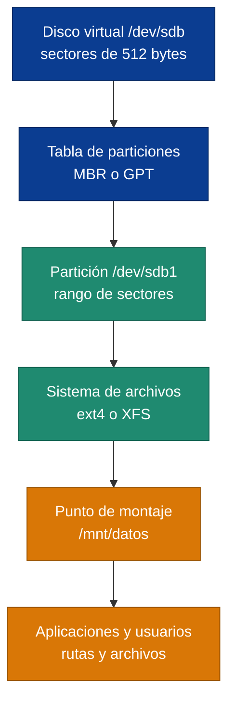
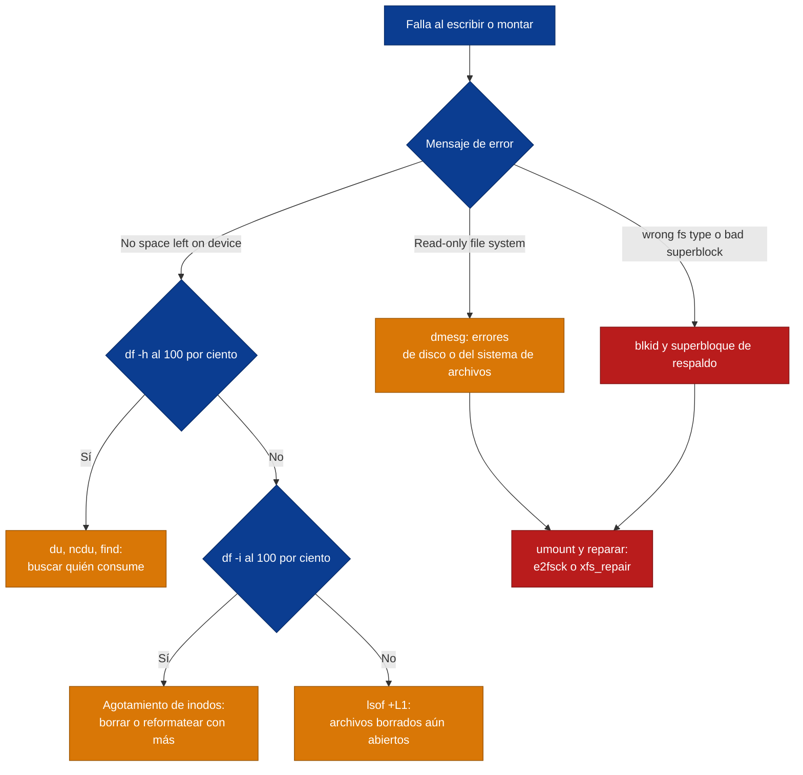

# Runbook del laboratorio: almacenamiento y sistemas de archivos en Linux


Esta es la guía que sigo, paso a paso, para dar la clase. Cada fase tiene un objetivo, los comandos con su explicación, una pregunta para la clase y un punto de control. Si el punto de control no sale como indico, me detengo y lo resuelvo antes de seguir, porque cada fase construye sobre la anterior.

## Cómo leer este documento

* El disco del laboratorio es siempre `/dev/sdb`. El disco del sistema es `/dev/sda` y no se toca.
* Los comandos con privilegios llevan `sudo`.
* Lo que va entre `<` y `>` lo reemplazo por el valor real que muestra el sistema.
* En las tablas de explicación desarmo cada comando en sus piezas: el programa, cada opción y cada argumento.

## Mapa de fases

| Fase | Tema | Qué logro |
|---|---|---|
| 0 | Preparación | Disco agregado, paquetes instalados, instantánea tomada |
| 1 | Reconocimiento | Leer el disco y su estado sin modificar nada |
| 2 | Capas y conceptos | Entender la pila disco, partición, sistema de archivos, montaje |
| 3 | Particionamiento | Tabla MBR con primarias, extendida y lógicas |
| 4 | Sistemas de archivos e inodos | Formatear en ext2, ext3, ext4 y XFS y entender los inodos |
| 5 | Montaje | Montar y desmontar con criterio |
| 6 | Persistencia | `/etc/fstab` sin riesgo de arranque |
| 7 | Carga de datos | Llenar el disco con datos de prueba y ver los punteros |
| 8 | Consumo de espacio | Saber quién ocupa el disco |
| 9 | Rendimiento de I/O | Medir y comparar |
| 10 | Ajuste fino y cambios | Optimizar, convertir y crecer |
| 11 | Fallas y reparación | Diagnosticar y reparar |
| 12 | GPT | La tabla moderna con `parted` y `sgdisk` |
| 13 | Cierre | Dejar el disco limpio |

---

## Fase 0: Preparación del entorno

**Objetivo:** dejar la VM lista, con el disco nuevo visible y todas las herramientas instaladas, para que ninguna fase se interrumpa por algo que faltó.

### 0.1 Tomar la instantánea de la VM

En VMware: menú de la VM, Snapshot, Take Snapshot, nombre `inicio-lab`. Es mi red de seguridad. Si algo sale mal en cualquier fase, vuelvo a este punto.

Un detalle que tengo en cuenta: una instantánea activa agrega una capa de cambios sobre el disco virtual y puede alterar un poco las mediciones de la Fase 9. Si quiero cifras limpias de rendimiento, hago esa fase con la instantánea eliminada o con el disco configurado como independiente.

### 0.2 Agregar el disco de 10 GB

En VMware: Edit virtual machine settings, Add, Hard Disk, tipo SCSI, Create a new virtual disk, 10 GB, guardado como un solo archivo. El disco SCSI se puede agregar con la VM encendida.

### 0.3 Hacer que el kernel vea el disco sin reiniciar

```bash
for h in /sys/class/scsi_host/host*/scan; do echo "- - -" | sudo tee "$h" > /dev/null; done
```

| Pieza | Significado |
|---|---|
| `for h in ...; do ...; done` | Recorre cada controlador SCSI que existe. |
| `/sys/class/scsi_host/host*/scan` | Archivo del kernel que dispara un reescaneo del bus. Hay uno por controlador (`host0`, `host1`, etc.). |
| `echo "- - -"` | Los tres guiones son comodines de canal, objetivo y LUN: escanea todo. |
| `sudo tee "$h"` | Escribe el texto en el archivo con privilegios. Uso `tee` porque la redirección `>` la ejecuta mi usuario, no root, y fallaría por permisos. |
| `> /dev/null` | Descarta la salida de `tee`, que repite lo que escribió. |

Es lo mismo que haría un administrador al agregar un disco a un servidor en producción sin reiniciar.

### 0.2 Actualizar los índices e instalar las herramientas

```bash
sudo apt update
sudo apt install -y xfsprogs parted gdisk smartmontools sysstat ncdu duf pv fio hdparm lsof psmisc
```

| Pieza | Significado |
|---|---|
| `apt update` | Descarga la lista actual de paquetes disponibles. No instala nada. |
| `apt install -y` | Instala los paquetes; `-y` responde "sí" a la confirmación. |
| `xfsprogs` | Herramientas de XFS: `mkfs.xfs`, `xfs_info`, `xfs_repair`, `xfs_admin`, `xfs_growfs`, `xfs_fsr`, `xfs_db`. |
| `parted`, `gdisk` | Particionadores para GPT: `parted` y `sgdisk`. |
| `smartmontools` | `smartctl`, para leer el estado S.M.A.R.T. |
| `sysstat` | `iostat`, para medir I/O. |
| `ncdu`, `duf` | Analizadores de consumo de disco. |
| `pv` | Mide el flujo de datos en una tubería. |
| `fio` | Generador de carga de I/O para benchmarks. |
| `hdparm` | Lectura y prueba básica del disco. |
| `lsof`, `psmisc` | `lsof` lista archivos abiertos; `psmisc` trae `fuser`. |

Los paquetes `util-linux` (`lsblk`, `fdisk`, `blkid`, `mount`, `findmnt`, `fstrim`, `wipefs`, `partx`) y `e2fsprogs` (`mkfs.ext4`, `tune2fs`, `e2fsck`, `debugfs`, `resize2fs`, `e4defrag`) ya vienen instalados en Ubuntu.

`dust` es opcional porque no está en los repositorios de 24.04. Si quiero usarlo en la Fase 8:

```bash
sudo apt install -y cargo
cargo install du-dust
export PATH="$HOME/.cargo/bin:$PATH"
```

`cargo install du-dust` compila el programa y lo deja en `~/.cargo/bin`, que por eso agrego al `PATH`.

### 0.3 Verificar que todo quedó instalado

```bash
for c in lsblk blkid fdisk sfdisk parted sgdisk smartctl iostat ncdu duf pv fio hdparm lsof fuser mkfs.xfs xfs_repair tune2fs e2fsck debugfs; do
  command -v "$c" > /dev/null && echo "ok     $c" || echo "falta  $c"
done
```

`command -v` imprime la ruta de un comando si existe y devuelve éxito; si no existe, devuelve error. El `&&` y el `||` eligen qué texto mostrar.

**Punto de control de la Fase 0:** ninguna línea dice `falta` y `lsblk` muestra un disco `sdb` de 10G sin hijos.

---

## Fase 1: Reconocimiento del disco

**Objetivo:** aprender a leer el estado del almacenamiento sin modificar nada. Es la primera regla de un administrador: mirar antes de tocar.

### 1.1 Listar los dispositivos de bloque con `lsblk`

```bash
lsblk
lsblk -o NAME,FSTYPE,LABEL,UUID,SIZE,RO,TYPE,MOUNTPOINT
lsblk -d -o NAME,SIZE,ROTA,MODEL
```

| Pieza | Significado |
|---|---|
| `lsblk` | Lista los dispositivos de bloque como un árbol. Lee la información de `/sys` y de la base de datos de udev. |
| `-o` | Elijo las columnas que quiero ver. |
| `NAME` | Nombre del dispositivo (`sdb`, `sdb1`). |
| `FSTYPE` | Sistema de archivos detectado, si hay uno. |
| `LABEL` | Etiqueta del sistema de archivos. |
| `UUID` | Identificador único del sistema de archivos. |
| `SIZE` | Capacidad. |
| `RO` | 1 si el dispositivo es de solo lectura, 0 si no. |
| `TYPE` | `disk`, `part`, `loop`, etc. |
| `MOUNTPOINT` | Directorio donde está montado. |
| `-d` | Solo los discos, sin sus particiones. |
| `ROTA` | 1 si es un disco rotativo, 0 si es de estado sólido. En una VM suele aparecer 0 o 1 sin que corresponda al hardware real. |

**Resultado esperado:** `sda` con sus particiones y `sdb` de 10G sin hijos, sin `FSTYPE` ni `UUID`.

### 1.2 Ver los archivos de dispositivo

```bash
ls -l /dev/sd*
```

| Pieza | Significado |
|---|---|
| `ls -l` | Listado largo con permisos, dueño y tipo. |
| `/dev/sd*` | Todos los nodos que empiezan por `sd`. |

En la salida, la primera letra de cada línea es `b`: dispositivo de bloque. Los dos números separados por coma (por ejemplo `8, 16`) son el número mayor, que identifica el controlador del kernel (8 es el de discos SCSI), y el número menor, que identifica el disco o la partición dentro de ese controlador.

### 1.3 Ver las particiones que conoce el kernel

```bash
cat /proc/partitions
```

`/proc/partitions` es un archivo virtual del kernel con cuatro columnas: número mayor, menor, tamaño en bloques de 1 KiB y nombre. Es la vista más directa de lo que el kernel tiene registrado.

### 1.4 Consultar firmas con `blkid`

```bash
sudo blkid /dev/sdb
echo $?
```

| Pieza | Significado |
|---|---|
| `blkid` | Lee las firmas de un dispositivo para identificar su sistema de archivos, UUID y etiqueta. |
| `/dev/sdb` | Dispositivo a consultar. |
| `echo $?` | Muestra el código de salida del comando anterior. |

**Resultado esperado:** no imprime nada y el código de salida es `2`. Eso significa que `blkid` no encontró ninguna firma: el disco está virgen. Este es el estado inicial que busco.

### 1.5 Ver la tabla de particiones con `fdisk -l`

```bash
sudo fdisk -l /dev/sdb
```

| Pieza | Significado |
|---|---|
| `fdisk` | Editor de particiones. |
| `-l` | Solo lista y sale, no abre el modo interactivo. |

Muestra el tamaño en bytes y en sectores, el tamaño de sector lógico y físico (normalmente 512 bytes) y el tipo de etiqueta de disco si existe. Todavía no debe aparecer ninguna tabla.

### 1.6 Consultar los atributos con `udevadm`

```bash
udevadm info --query=property --name=/dev/sdb | grep -E 'ID_(MODEL|SERIAL|BUS)|DEVTYPE'
ls -l /dev/disk/by-id/ /dev/disk/by-path/
```

| Pieza | Significado |
|---|---|
| `udevadm info` | Consulta la base de datos de udev, que es el servicio que crea los nodos de `/dev`. |
| `--query=property` | Devuelve las propiedades del dispositivo como `CLAVE=valor`. |
| `--name=/dev/sdb` | Dispositivo sobre el que pregunto. |
| `grep -E '...'` | Filtra con expresión regular extendida solo las claves que me interesan. |
| `/dev/disk/by-id/`, `/dev/disk/by-path/` | Directorios con enlaces simbólicos que dan nombres estables al disco, según su identificador o su posición en el bus. |

Les explico por qué esto importa: `/dev/sdb` puede cambiar de nombre entre reinicios si se agregan o quitan discos. Los nombres de `by-id` y `by-uuid` no cambian.

### 1.7 Revisar el estado S.M.A.R.T. con `smartctl`

```bash
sudo smartctl -i /dev/sdb
sudo smartctl -H /dev/sdb
```

| Pieza | Significado |
|---|---|
| `smartctl` | Cliente de S.M.A.R.T., el sistema de autodiagnóstico de los discos. |
| `-i` | Información del dispositivo: modelo, serie, capacidad. |
| `-H` | Resultado de la autoevaluación general de salud. |

En un disco físico, `-H` devuelve `PASSED` o `FAILED`. En un disco virtual de VMware lo habitual es que diga que S.M.A.R.T. no está disponible, porque el disco no es hardware real. Lo muestro igual: así saben qué comando usar en un servidor físico y qué respuesta esperar en una VM. Para ver todos los atributos en un disco físico se usa `sudo smartctl -a /dev/sdX`.

### 1.8 Leer los atributos del kernel en `/sys`

```bash
cat /sys/block/sdb/size
cat /sys/block/sdb/queue/rotational
cat /sys/block/sdb/queue/logical_block_size
cat /sys/block/sdb/queue/scheduler
sudo dmesg -T | grep -i sdb
```

| Archivo o comando | Significado |
|---|---|
| `/sys/block/sdb/size` | Tamaño en sectores de 512 bytes. Para 10 GiB debe dar `20971520`. |
| `queue/rotational` | 0 si el kernel lo trata como no rotativo. |
| `queue/logical_block_size` | Tamaño de sector lógico, normalmente `512`. |
| `queue/scheduler` | Planificador de I/O activo, entre corchetes. Lo uso en la Fase 9. |
| `dmesg -T` | Mensajes del kernel con fecha legible. Necesita `sudo` en Ubuntu 24.04. |
| `grep -i sdb` | Filtra las líneas del disco, sin distinguir mayúsculas. |

**Para la clase:** pregunto por qué `blkid` no devolvió nada. La respuesta es que un disco sin firma no tiene sistema de archivos ni tabla de particiones todavía.

**Punto de control de la Fase 1:** `lsblk` muestra `sdb` de 10G, `blkid /dev/sdb` no imprime nada y `/sys/block/sdb/size` da `20971520`.

---

## Fase 2: Capas y conceptos

**Objetivo:** tener claro qué es cada capa antes de crear nada, para que cada comando de las siguientes fases tenga sentido.



Lo que explico, en este orden:

* **Sector:** unidad mínima del disco, 512 bytes aquí. Todo lo demás se mide en sectores.
* **Tabla de particiones:** un mapa al inicio del disco que dice qué rango de sectores pertenece a cada partición.
* **Partición:** un trozo del disco con su propio principio y fin. Para el sistema operativo es un dispositivo de bloque más.
* **Sistema de archivos:** la estructura que organiza nombres, permisos y datos dentro de la partición. Una partición sin sistema de archivos no puede guardar archivos.
* **Montaje:** conectar el sistema de archivos a un directorio del árbol global. Sin montaje, el contenido existe pero no es accesible por ruta.

| Característica | MBR | GPT |
|---|---|---|
| Ubicación de la tabla | Primer sector del disco (512 bytes) | Cabecera al inicio y copia de respaldo al final |
| Límite de tamaño de disco | 2 TiB | Prácticamente sin límite |
| Particiones | 4 primarias, o 3 primarias y 1 extendida con lógicas | 128 por defecto |
| Identificador de partición | Solo número | PARTUUID y nombre de partición |
| Herramienta del laboratorio | `fdisk` | `parted` y `sgdisk` |

El primer sector de un disco MBR tiene tres partes: 446 bytes de código de arranque, 64 bytes de tabla (cuatro entradas de 16 bytes) y 2 bytes de firma. Por eso solo caben cuatro entradas, y por eso existe la partición extendida: es una de esas cuatro entradas que apunta a una zona donde viven las particiones lógicas.

**Para la clase:** pido que calculen cuántos bytes ocupa la tabla de particiones MBR (64) y por qué eso fija el límite de cuatro.

**Punto de control de la Fase 2:** pueden explicar con sus palabras la diferencia entre partición, sistema de archivos y punto de montaje.

---

## Fase 3: Particionamiento con `fdisk`

**Objetivo:** construir esta tabla MBR sobre `/dev/sdb`.

| Partición | Tipo | Tamaño | Uso posterior |
|---|---|---|---|
| `sdb1` | primaria | 2 GiB | ext4 `datos` |
| `sdb2` | primaria | 2 GiB | xfs `xfsdata` |
| `sdb3` | primaria | 1 GiB | ext2 `legacy` |
| `sdb4` | extendida | resto (unos 5 GiB) | contenedor de lógicas |
| `sdb5` | lógica | 1 GiB | ext3 `journal3` |
| `sdb6` | lógica | 1 GiB | ext4 `inodos` |

El espacio sobrante dentro de la extendida (unos 3 GiB) lo dejo libre a propósito: lo uso en la Fase 10 para crecer una partición.

### 3.1 Respaldar el primer sector antes de tocar nada

```bash
sudo dd if=/dev/sdb of=/root/sdb-mbr-inicial.bin bs=512 count=1
```

| Pieza | Significado |
|---|---|
| `dd` | Copia datos bloque a bloque. |
| `if=/dev/sdb` | Archivo de entrada, el disco completo. |
| `of=/root/sdb-mbr-inicial.bin` | Archivo de salida donde guardo la copia. |
| `bs=512` | Tamaño de bloque: 512 bytes, un sector. |
| `count=1` | Copia un solo bloque, el primer sector. |

Es el respaldo del MBR. Con el disco vacío no guarda mucho, pero así practico el hábito de respaldar el sector 0 antes de modificar un disco real.

### 3.2 Abrir `fdisk`

```bash
sudo fdisk /dev/sdb
```

`fdisk` en modo interactivo opera sobre el disco indicado. Todos los cambios quedan en memoria hasta que escribo `w`. Si me equivoco, `q` sale sin guardar nada.

### 3.3 Secuencia interactiva

Dentro del prompt `Command (m for help):` ejecuto esto, en este orden:

| Tecla | Respuesta a las preguntas | Qué hace |
|---|---|---|
| `p` | | Imprime la tabla actual. Debe estar vacía. |
| `o` | | Crea una tabla de particiones DOS (MBR) vacía. Con `g` se crearía una GPT. |
| `n` | `p`, `1`, Enter, `+2G` | Nueva partición primaria 1 desde el primer sector libre, de 2 GiB. |
| `n` | `p`, `2`, Enter, `+2G` | Primaria 2 de 2 GiB. |
| `n` | `p`, `3`, Enter, `+1G` | Primaria 3 de 1 GiB. |
| `n` | `e`, `4`, Enter, Enter | Partición extendida 4: primer sector por defecto y último sector por defecto, o sea todo el resto del disco. |
| `n` | Enter, `+1G` | Con las cuatro entradas MBR ocupadas, `fdisk` crea una lógica automáticamente (la 5). Si pregunta el tipo, respondo `l`. |
| `n` | Enter, `+1G` | Lógica 6 de 1 GiB. |
| `p` | | Verifico el resultado antes de escribir. |
| `w` | | Escribe la tabla en el disco y sale. |

Qué significan las preguntas que aparecen:

| Pregunta | Significado |
|---|---|
| `Select (default p)` | Tipo de partición: `p` primaria, `e` extendida. |
| `Partition number` | Número de la partición dentro de la tabla. |
| `First sector` | Sector donde empieza. Enter acepta el primer sector libre, que por alineación es el `2048`, es decir 1 MiB desde el inicio. |
| `Last sector, +/-sectors or +/-size{K,M,G,T,P}` | Dónde termina. `+2G` significa 2 GiB a partir del inicio. Enter toma todo lo libre. |

Comandos de `fdisk` que explico aunque no los use ahora:

| Tecla | Función |
|---|---|
| `m` | Ayuda con el menú completo. |
| `d` | Borra una partición. |
| `t` | Cambia el tipo de una partición. `L` lista los códigos; `83` es Linux, `82` es swap, `5` es extendida. |
| `i` | Información detallada de una partición. |
| `F` | Muestra el espacio libre sin particionar. |
| `u` | Alterna entre mostrar en sectores y en unidades. |
| `q` | Sale sin guardar. |

### 3.4 Avisar al kernel y verificar

```bash
sudo partprobe /dev/sdb
sudo udevadm settle
lsblk /dev/sdb
cat /proc/partitions
```

| Pieza | Significado |
|---|---|
| `partprobe` | Pide al kernel que relea la tabla de particiones sin reiniciar. Normalmente `fdisk` ya lo intenta al escribir; este comando lo garantiza. |
| `udevadm settle` | Espera a que udev termine de crear los nodos `/dev/sdb1`, etc. Evita errores por ejecutar el siguiente comando demasiado pronto. |
| `lsblk /dev/sdb` | Muestra el árbol del disco con sus particiones. |

**Resultado esperado:** `sdb1` 2G, `sdb2` 2G, `sdb3` 1G, `sdb4` de `1K` y `sdb5` y `sdb6` de 1G. La extendida `sdb4` aparece con tamaño `1K` porque el kernel solo registra la cabecera del contenedor, no el espacio que abarca.

### 3.5 Respaldar la tabla de particiones

```bash
sudo sfdisk -d /dev/sdb | sudo tee /root/sdb-particiones.dump > /dev/null
sudo cat /root/sdb-particiones.dump
```

| Pieza | Significado |
|---|---|
| `sfdisk -d` | Vuelca la tabla de particiones como texto, en un formato que `sfdisk` sabe reimportar. |
| `sudo tee ... > /dev/null` | Guarda el volcado en `/root` con privilegios, sin repetirlo en pantalla. |

Para restaurar la tabla en caso de desastre: `sudo sfdisk /dev/sdb < /root/sdb-particiones.dump`. Es el respaldo más pequeño y más útil que puedo tener de un disco.

**Para la clase:** pregunto cuántas particiones primarias hay y por qué se creó una lógica sin pedir el tipo.

**Punto de control de la Fase 3:**

```bash
lsblk -o NAME,SIZE,TYPE /dev/sdb
```

Deben aparecer seis entradas de partición, con `sdb4` de 1K, y el archivo `/root/sdb-particiones.dump` debe existir.

---

## Fase 4: Sistemas de archivos e inodos

**Objetivo:** dar formato a cada partición con un sistema de archivos distinto y entender cómo se identifica un archivo por dentro.

### 4.1 Qué es un inodo

Un inodo es una estructura de datos que guarda los metadatos de un archivo: permisos, dueño, tamaño, marcas de tiempo, cantidad de enlaces y las direcciones de los bloques donde están sus datos. No guarda el nombre del archivo. El nombre vive en el directorio, que es una tabla de pares nombre y número de inodo.

Un sistema de archivos reserva su cantidad de inodos cuando se crea. Eso fija cuántos archivos puede tener, sin importar el espacio libre.

Cómo se direccionan los datos en ext2 y ext3, con bloques de 4 KiB y punteros de 4 bytes (1024 punteros por bloque):

| Tipo de puntero | Cantidad | Qué cubre |
|---|---|---|
| Directos | 12 | 12 bloques, 48 KiB |
| Indirecto simple | 1 bloque de 1024 punteros | 4 MiB |
| Indirecto doble | 1024 bloques de 1024 punteros | 4 GiB |
| Indirecto triple | 1024 por 1024 por 1024 punteros | 4 TiB |

Los directos apuntan a bloques de datos de forma inmediata. Los indirectos agregan un nivel: el puntero lleva a un bloque que contiene más punteros. Cuantos más niveles, más lecturas hacen falta para llegar al dato, y por eso los archivos grandes son más lentos de direccionar en ext2 y ext3. En ext4 y XFS se usan extents: un rango continuo de bloques descrito con una sola entrada (inicio y longitud). Es más compacto y rápido.

### 4.2 Ver un inodo real

```bash
ls -li /etc/hostname
stat /etc/hostname
df -i /
```

| Pieza | Significado |
|---|---|
| `ls -li` | Listado largo con el número de inodo como primera columna (`-i`). |
| `stat` | Muestra todos los metadatos del inodo. |
| `df -i` | Muestra el uso de inodos en lugar del uso de bytes. |

Campos de `stat` que explico:

| Campo | Significado |
|---|---|
| `Size` | Tamaño del contenido en bytes. |
| `Blocks` | Bloques de 512 bytes realmente asignados. |
| `IO Block` | Tamaño de bloque preferido para I/O. |
| `Inode` | Número de inodo. |
| `Links` | Cuántos nombres (enlaces duros) apuntan a este inodo. |
| `Access` | Permisos en forma simbólica y numérica, dueño y grupo. |
| `Access`, `Modify`, `Change`, `Birth` (fechas) | Último acceso, última modificación del contenido, último cambio de metadatos y creación. |

### 4.3 Ver los valores por defecto de `mkfs`

```bash
cat /etc/mke2fs.conf
```

Es el archivo de configuración que `mkfs.ext2`, `mkfs.ext3` y `mkfs.ext4` leen para sus valores por defecto: tamaño de bloque (`blocksize`), tamaño de inodo (`inode_size`) y relación de bytes por inodo (`inode_ratio`). Con `inode_ratio = 16384` se reserva un inodo por cada 16 KiB de partición. Por eso una partición de 2 GiB termina con 131072 inodos.

### 4.4 Crear los sistemas de archivos

Antes de formatear confirmo con `lsblk` que estoy sobre `sdb` y no sobre `sda`. Formatear destruye lo que haya en la partición.

```bash
sudo mkfs.ext4 -L datos /dev/sdb1
sudo mkfs.xfs  -L xfsdata /dev/sdb2
sudo mkfs.ext2 -L legacy /dev/sdb3
sudo mkfs.ext3 -L journal3 /dev/sdb5
sudo mkfs.ext4 -L inodos -N 2048 /dev/sdb6
```

| Pieza | Significado |
|---|---|
| `mkfs.ext4`, `mkfs.ext3`, `mkfs.ext2` | Crean el sistema de archivos de esa familia. ext2 no tiene journal, ext3 agrega journal, ext4 agrega extents y mejoras de rendimiento. |
| `mkfs.xfs` | Crea XFS, orientado a archivos grandes y alta concurrencia. |
| `-L etiqueta` | Asigna una etiqueta al volumen, para identificarlo por nombre. En XFS el máximo son 12 caracteres. |
| `-N 2048` | Fija la cantidad de inodos en 2048 en lugar de la calculada. Lo uso en `sdb6` para agotar los inodos en la Fase 7 sin esperar horas. |
| `/dev/sdbN` | Partición que se formatea. |

Si una partición ya tuviera un sistema de archivos, `mkfs.xfs` se negaría. La opción `-f` fuerza la sobrescritura. La uso con cuidado y solo cuando estoy seguro de qué estoy borrando.

La salida de `mkfs.ext4` informa estos datos, y los leo con la clase:

| Línea de salida | Significado |
|---|---|
| `Creating filesystem with N 4k blocks and M inodes` | Cuántos bloques de 4 KiB y cuántos inodos se reservaron. |
| `Filesystem UUID` | Identificador único generado. |
| `Superblock backups stored on blocks` | Ubicaciones de las copias del superbloque. Las uso en la Fase 11. |
| `Creating journal` | Se creó el registro de transacciones (no aparece en ext2). |

### 4.5 Verificar el resultado

```bash
sudo blkid
lsblk -f /dev/sdb
```

`lsblk -f` muestra `FSTYPE`, `LABEL`, `UUID` y el uso. Ahora `blkid /dev/sdb1` ya devuelve datos, a diferencia de la Fase 1.

**Para la clase:** pregunto por qué `sdb6` tendrá muchos menos archivos posibles que `sdb1` si es solo la mitad de grande. La respuesta está en `-N 2048`.

**Punto de control de la Fase 4:** `lsblk -f` muestra `ext4`, `xfs`, `ext2`, `ext3` y `ext4` en las particiones 1, 2, 3, 5 y 6, cada una con su etiqueta y UUID.

---

## Fase 5: Montaje y desmontaje

**Objetivo:** conectar cada sistema de archivos al árbol de directorios, ver cómo se comporta el montaje y aprender a desmontar sin perder datos.

### 5.1 Crear los puntos de montaje

```bash
sudo mkdir -p /mnt/datos /mnt/xfsdata /mnt/legacy /mnt/journal3 /mnt/inodos
```

| Pieza | Significado |
|---|---|
| `mkdir` | Crea directorios. |
| `-p` | Crea los directorios intermedios si faltan y no falla si ya existen. |
| `/mnt` | Directorio convencional para montajes temporales o manuales. |

Un punto de montaje es un directorio normal y vacío. El sistema de archivos se "pega" encima.

### 5.2 Demostración: montar sobre un directorio con contenido

```bash
echo "estoy en el disco raiz" | sudo tee /mnt/datos/oculto.txt
sudo mount /dev/sdb1 /mnt/datos
ls -la /mnt/datos
```

| Pieza | Significado |
|---|---|
| `tee` | Escribe el texto en el archivo con privilegios. |
| `mount /dev/sdb1 /mnt/datos` | Conecta la partición al directorio. |
| `ls -la` | Lista todo, incluidos los archivos ocultos. |

**Resultado esperado:** solo aparece `lost+found`. `oculto.txt` desapareció de la vista. No se borró: quedó tapado por el montaje. Lo compruebo así:

```bash
sudo umount /mnt/datos
ls /mnt/datos
sudo rm /mnt/datos/oculto.txt
sudo mount /dev/sdb1 /mnt/datos
```

`umount` desconecta y el archivo reaparece. Esto explica un error clásico en producción: montar un disco sobre un directorio que ya tenía datos y creer que se perdieron.

`lost+found` es un directorio que `mkfs.ext*` crea para que `e2fsck` deposite allí los fragmentos de archivos que recupera en una reparación. No existe en XFS.

### 5.3 Montar el resto

```bash
sudo mount /dev/sdb2 /mnt/xfsdata
sudo mount /dev/sdb5 /mnt/journal3
sudo mount /dev/sdb6 /mnt/inodos
sudo mount -o noexec,nodev,nosuid /dev/sdb3 /mnt/legacy
```

| Pieza | Significado |
|---|---|
| `mount DISPOSITIVO DIRECTORIO` | Sintaxis básica. El tipo de sistema de archivos se detecta solo desde la firma. Se puede indicar con `-t ext4`. |
| `-o opciones` | Lista de opciones de montaje separadas por coma. |
| `noexec` | Impide ejecutar binarios desde ese sistema de archivos. |
| `nodev` | Ignora archivos de dispositivo que haya en él. |
| `nosuid` | Ignora los bits setuid y setgid. |

Las tres opciones juntas son una práctica de endurecimiento para particiones de datos que no deben ejecutar código.

### 5.4 Verificar los montajes

```bash
findmnt /mnt/datos
findmnt -o TARGET,SOURCE,FSTYPE,OPTIONS | grep /mnt
mount | grep sdb
cat /proc/self/mounts | grep sdb
ls -l /etc/mtab
```

| Pieza | Significado |
|---|---|
| `findmnt` | Muestra los montajes en forma de árbol o tabla, con salida legible. |
| `-o TARGET,SOURCE,FSTYPE,OPTIONS` | Columnas: dónde, qué dispositivo, qué tipo y con qué opciones. |
| `mount` sin argumentos | Lista los montajes activos. |
| `/proc/self/mounts` | Archivo del kernel con la tabla real de montajes. |
| `/etc/mtab` | En sistemas modernos es un enlace simbólico a `../proc/self/mounts`, así que refleja lo que el kernel tiene montado. Es lo que busco en `ls -l`. |

### 5.5 Dar propiedad de uso al usuario

```bash
sudo chown "$USER":"$USER" /mnt/datos /mnt/xfsdata /mnt/legacy /mnt/journal3 /mnt/inodos
```

La raíz de cada sistema de archivos recién creado pertenece a root. `chown usuario:grupo` cambia el dueño y el grupo. No uso `-R`, porque solo quiero cambiar el directorio raíz del montaje y no recorrer su contenido. El cambio queda guardado dentro del sistema de archivos, así que sobrevive a los desmontajes.

### 5.6 Demostrar `noexec`

```bash
sudo cp /bin/ls /mnt/legacy/ls_prueba
/mnt/legacy/ls_prueba
```

**Resultado esperado:** `Permission denied`. El binario es válido, pero el montaje no permite ejecutarlo.

### 5.7 Desmontar: caso normal y caso ocupado

```bash
sudo umount /mnt/legacy
sudo mount -o noexec,nodev,nosuid /dev/sdb3 /mnt/legacy
```

Para provocar un desmontaje fallido, abro una segunda terminal y ejecuto `cd /mnt/datos`. En la primera:

```bash
sudo umount /mnt/datos
fuser -vm /mnt/datos
sudo lsof +f -- /mnt/datos
```

| Pieza | Significado |
|---|---|
| `umount` | Desconecta el sistema de archivos y vacía antes los buffers de escritura pendientes. Falla con `target is busy` si algo lo está usando. |
| `fuser -vm` | Muestra qué procesos usan el montaje. `-v` es detallado, `-m` indica que el argumento es un sistema de archivos. |
| `lsof +f -- /mnt/datos` | Lista los archivos abiertos en ese sistema de archivos. `+f --` trata el argumento como punto de montaje. |

La solución correcta es cerrar el proceso o salir del directorio, y volver a ejecutar `umount`. Existen `umount -l` (lazy, desconecta ahora y limpia cuando ya nadie lo use) y `umount -f` (forzar, útil sobre todo en red). Los menciono, pero les aclaro que son último recurso porque pueden dejar procesos con errores.

### 5.8 Montar por etiqueta y por UUID

```bash
sudo umount /mnt/datos
sudo mount LABEL=datos /mnt/datos
sudo umount /mnt/datos
sudo mount UUID=$(sudo blkid -s UUID -o value /dev/sdb1) /mnt/datos
```

| Pieza | Significado |
|---|---|
| `LABEL=datos` | `mount` busca el dispositivo cuya etiqueta es `datos`. |
| `UUID=...` | `mount` busca el dispositivo con ese UUID. |
| `blkid -s UUID -o value` | `-s UUID` limita la salida a esa etiqueta; `-o value` imprime solo el valor, sin el nombre del campo. |
| `$(...)` | Sustituye el comando por su salida. |

**Para la clase:** pregunto por qué se prefiere UUID a `/dev/sdb1`. La respuesta es que los nombres `sdX` pueden cambiar entre arranques y el UUID viaja con el sistema de archivos.

**Punto de control de la Fase 5:** `findmnt -o TARGET,SOURCE,FSTYPE | grep /mnt` muestra los cinco montajes, y `/mnt/datos` queda montado y escribible por mi usuario.

---

## Fase 6: Persistencia con `/etc/fstab`

**Objetivo:** que los montajes se repitan solos en cada arranque, sin poner en riesgo el arranque.

### 6.1 Respaldar el archivo original

```bash
sudo cp -a /etc/fstab /etc/fstab.pre-lab
```

`cp -a` copia en modo archivo: conserva permisos, dueño y fechas. Este respaldo es el que uso en la Fase 13 para devolver el sistema al estado inicial.

### 6.2 Entender las seis columnas

```bash
cat /etc/fstab
```

`/etc/fstab` es la tabla estática de sistemas de archivos que systemd lee al arrancar. Cada línea tiene seis campos separados por espacios:

| Campo | Ejemplo | Significado |
|---|---|---|
| 1. Dispositivo | `UUID=xxxx` | Qué se monta. Prefiero UUID. |
| 2. Punto de montaje | `/mnt/datos` | Dónde se monta. El directorio debe existir. |
| 3. Tipo | `ext4` | Sistema de archivos. |
| 4. Opciones | `defaults,noatime,nofail` | Opciones de montaje separadas por coma. |
| 5. `dump` | `0` | Herramienta de respaldo `dump`. En la práctica se deja en 0. |
| 6. `passno` | `2` | Orden de `fsck` al arrancar: 1 para la raíz, 2 para el resto, 0 para no revisar. |

Opciones que uso hoy:

| Opción | Significado |
|---|---|
| `defaults` | Equivale a `rw,suid,dev,exec,auto,nouser,async`. |
| `noatime` | No actualiza la hora de acceso en cada lectura. Reduce escrituras y mejora rendimiento. |
| `nofail` | Si el dispositivo no existe, el arranque continúa en lugar de caer en modo de emergencia. |
| `nodev,nosuid,noexec` | Endurecimiento para la partición `legacy`. |

XFS lleva `passno` en `0` porque `fsck.xfs` no repara nada en el arranque. Para XFS la reparación es manual con `xfs_repair`.

### 6.3 Agregar las entradas

Obtengo cada UUID y lo escribo en una línea. El método con `printf` evita errores de transcripción:

```bash
printf 'UUID=%s /mnt/datos    ext4 defaults,noatime,nofail 0 2\n' "$(sudo blkid -s UUID -o value /dev/sdb1)" | sudo tee -a /etc/fstab
printf 'UUID=%s /mnt/xfsdata  xfs  defaults,noatime,nofail 0 0\n' "$(sudo blkid -s UUID -o value /dev/sdb2)" | sudo tee -a /etc/fstab
printf 'UUID=%s /mnt/legacy   ext2 defaults,nodev,nosuid,noexec,nofail 0 2\n' "$(sudo blkid -s UUID -o value /dev/sdb3)" | sudo tee -a /etc/fstab
printf 'UUID=%s /mnt/journal3 ext3 defaults,nofail 0 2\n' "$(sudo blkid -s UUID -o value /dev/sdb5)" | sudo tee -a /etc/fstab
printf 'UUID=%s /mnt/inodos   ext4 defaults,nofail 0 2\n' "$(sudo blkid -s UUID -o value /dev/sdb6)" | sudo tee -a /etc/fstab
```

| Pieza | Significado |
|---|---|
| `printf '...%s...\n' valor` | Imprime la plantilla y reemplaza `%s` por el valor. `\n` cierra la línea. |
| `$(sudo blkid -s UUID -o value /dev/sdbN)` | Obtiene el UUID de la partición. |
| `sudo tee -a /etc/fstab` | Agrega al final del archivo (`-a` es append) con privilegios. |

La alternativa manual es `sudo nano /etc/fstab` y escribir las líneas con el UUID copiado. Muestro las dos formas, pero recomiendo la primera.

### 6.4 Validar antes de reiniciar

```bash
sudo umount /mnt/datos /mnt/xfsdata /mnt/legacy /mnt/journal3 /mnt/inodos
sudo systemctl daemon-reload
sudo findmnt --verify --verbose
sudo mount -a
findmnt -o TARGET,SOURCE,FSTYPE,OPTIONS | grep /mnt
```

| Pieza | Significado |
|---|---|
| `umount ...` | Parto de un estado desmontado para probar de verdad el `fstab`. |
| `systemctl daemon-reload` | Hace que systemd relea `/etc/fstab`. Sin esto avisa de que usa la versión vieja. |
| `findmnt --verify --verbose` | Revisa la sintaxis y comprueba que los dispositivos y tipos existan. |
| `mount -a` | Monta todo lo que está en `fstab` y no está montado. Si no da error, el archivo es válido. |

### 6.5 Prueba de arranque

```bash
sudo reboot
```

Al volver, `findmnt | grep /mnt` y `df -hT | grep /mnt` deben mostrar los cinco montajes sin intervención.

### 6.6 Qué pasa si el `fstab` está mal

Un UUID incorrecto sin `nofail` puede mandar al sistema a modo de emergencia en el arranque. Se recupera así: en el modo de emergencia entro con la contraseña de root y ejecuto `mount -o remount,rw /` para poder escribir en la raíz, corrijo con `nano /etc/fstab`, aplico `systemctl daemon-reload`, pruebo con `mount -a` y reinicio. Lo explico en pizarra. Si quiero hacerlo en vivo, lo hago solo sobre la instantánea.

**Para la clase:** pregunto qué hace `nofail` y por qué lo pongo en discos de datos.

**Punto de control de la Fase 6:** tras el reinicio, los cinco montajes aparecen y `sudo findmnt --verify` no reporta errores.

---

## Fase 7: Carga de datos de prueba

**Objetivo:** llenar el disco con datos controlados para estudiar el consumo, el rendimiento y las fallas.

### 7.1 Archivos grandes: `fallocate`, `dd`, `truncate`

```bash
fallocate -l 500M /mnt/datos/reserva.img
dd if=/dev/zero of=/mnt/datos/ceros.bin bs=1M count=1024 status=progress
dd if=/dev/urandom of=/mnt/datos/aleatorio.bin bs=1M count=200 status=progress
truncate -s 5G /mnt/datos/disperso.img
ls -lh /mnt/datos
du -h /mnt/datos/*
sync
```

| Pieza | Significado |
|---|---|
| `fallocate -l 500M` | Reserva 500 MiB de bloques al instante, sin escribir datos. |
| `dd` | Copia datos. |
| `if=/dev/zero` | Fuente que produce ceros sin fin. |
| `if=/dev/urandom` | Fuente de datos aleatorios, que no se pueden comprimir ni son dispersos. |
| `of=` | Archivo destino. |
| `bs=1M count=1024` | 1024 bloques de 1 MiB: 1 GiB en total. |
| `status=progress` | Muestra la velocidad y el avance. |
| `truncate -s 5G` | Fija el tamaño aparente del archivo en 5 GiB sin asignar bloques: crea un archivo disperso. |
| `ls -lh` | Tamaño aparente en formato legible. |
| `du -h` | Espacio realmente asignado. |
| `sync` | Fuerza el vaciado de los buffers de escritura a disco. |

**Lo que muestro:** `disperso.img` aparece de 5G en `ls` y casi 0 en `du`. El tamaño aparente y el espacio ocupado son dos cosas distintas. Por eso `df` y `ls` pueden discrepar.

### 7.2 Medir el flujo con `pv`

```bash
pv /mnt/datos/ceros.bin > /mnt/xfsdata/ceros.bin
```

`pv` lee el archivo y lo pasa a la salida mostrando velocidad, tiempo y porcentaje. La redirección `>` escribe el resultado en el sistema de archivos XFS. Es una copia con medidor de progreso.

### 7.3 Muchos archivos pequeños

```bash
mkdir /mnt/datos/pequenos /mnt/xfsdata/pequenos
time (cd /mnt/datos/pequenos && seq 1 20000 | xargs touch)
time (cd /mnt/xfsdata/pequenos && seq 1 20000 | xargs touch)
df -i /mnt/datos /mnt/xfsdata
```

| Pieza | Significado |
|---|---|
| `seq 1 20000` | Genera los números del 1 al 20000, uno por línea. |
| `xargs touch` | Convierte esas líneas en argumentos de `touch`, que crea un archivo vacío por cada uno. |
| `( cd ... && ... )` | Subshell: cambia de directorio solo dentro de los paréntesis, así no dejo mi shell parado dentro de un montaje. |
| `time` | Mide el tiempo que tarda. |

Cada archivo creado consume un inodo, aunque no ocupe datos. `df -i` lo refleja en la columna `IUsed`. Comparo los tiempos entre ext4 y XFS.

### 7.4 Agotar los inodos

```bash
(cd /mnt/inodos && seq 1 3000 | xargs touch 2>&1 | tail -n 3)
df -h /mnt/inodos
df -i /mnt/inodos
```

`sdb6` solo tiene 2048 inodos, y varios están reservados para el sistema. Alrededor del archivo 2030, `touch` empieza a fallar con `No space left on device`. Lo que muestro con los dos `df`:

* `df -h`: casi 1 GiB libre.
* `df -i`: `IUse%` al 100 por ciento.

Es el error que más desconcierta en producción: "disco lleno" con espacio libre. La solución está en la Fase 11.

### 7.5 Ver los punteros directos e indirectos

```bash
dd if=/dev/urandom of=/mnt/journal3/grande.bin bs=1M count=100
cp /mnt/journal3/grande.bin /mnt/datos/grande.bin
sudo debugfs -R "stat /grande.bin" /dev/sdb5
sudo debugfs -R "stat /grande.bin" /dev/sdb1
filefrag -v /mnt/datos/grande.bin
```

| Pieza | Significado |
|---|---|
| `debugfs` | Depurador de ext2, ext3 y ext4. Abre el sistema de archivos en solo lectura por defecto. |
| `-R "stat /grande.bin"` | Ejecuta un solo comando de `debugfs`: muestra el inodo del archivo. La ruta es relativa a la raíz del sistema de archivos, no del sistema. |
| `/dev/sdb5` | Dispositivo que se inspecciona. |
| `filefrag -v` | Muestra los extents del archivo y su fragmentación. |

**Qué debo ver:**

* En `sdb5` (ext3): en la sección `BLOCKS` aparecen los 12 bloques directos y luego las marcas `(IND)` y `(DIND)`. Es la teoría de la Fase 4 hecha visible.
* En `sdb1` (ext4): aparece `EXTENTS` con pocos rangos. El mismo archivo se describe con muchas menos entradas.

**Para la clase:** pregunto por qué 100 MiB necesitan indirección doble en ext3. La respuesta es que 48 KiB directos más 4 MiB indirectos simples no alcanzan.

**Punto de control de la Fase 7:** `df -i /mnt/inodos` muestra `IUse%` al 100 por ciento mientras `df -h /mnt/inodos` muestra espacio libre, y `debugfs` mostró `(IND)` y `(DIND)`.

---

## Fase 8: Consumo de espacio

**Objetivo:** saber cuánto espacio queda y quién lo consume.

### 8.1 `df`: espacio por sistema de archivos

```bash
df -h
df -hT -x tmpfs -x devtmpfs -x squashfs
df -i
df -h /mnt/datos
df --output=source,fstype,size,used,avail,pcent,target /mnt/datos
```

| Pieza | Significado |
|---|---|
| `df` | "Disk free": espacio total, usado y disponible de cada sistema de archivos montado. |
| `-h` | Tamaños legibles (potencias de 1024). |
| `-T` | Agrega la columna de tipo de sistema de archivos. |
| `-x tmpfs -x devtmpfs -x squashfs` | Excluye esos tipos. En Ubuntu, los paquetes snap crean muchos montajes `squashfs` que ensucian la salida. |
| `-i` | Uso de inodos en lugar de bytes. |
| `--output=campos` | Elijo qué columnas mostrar. |
| Un directorio como argumento | `df` informa del sistema de archivos que contiene ese directorio. |

### 8.2 `du`: consumo por directorio

```bash
du -sh /mnt/datos
du -h --max-depth=1 /mnt/datos | sort -h
du -xh --max-depth=1 /mnt/datos
du -sh --apparent-size /mnt/datos/disperso.img
```

| Pieza | Significado |
|---|---|
| `du` | "Disk usage": calcula el espacio que ocupa un árbol de archivos. |
| `-s` | Solo el total (summary). |
| `-h` | Formato legible. |
| `--max-depth=1` | Baja un solo nivel de subdirectorios. |
| `sort -h` | Ordena respetando los sufijos K, M y G. |
| `-x` | No cruza a otros sistemas de archivos montados dentro del árbol. |
| `--apparent-size` | Usa el tamaño aparente del archivo en lugar de los bloques asignados. |

### 8.3 `ncdu`: explorador interactivo

```bash
sudo ncdu -x /mnt/datos
```

`ncdu` escanea y muestra los directorios ordenados por tamaño, con navegación por teclado. `-x` no sale del sistema de archivos. Teclas que uso: flechas para moverse, Enter para entrar, `d` para borrar, `n` y `s` para ordenar por nombre o tamaño, `q` para salir.

### 8.4 `duf` y `dust`

```bash
duf
duf /mnt/datos
dust -d 1 /mnt/datos
```

| Pieza | Significado |
|---|---|
| `duf` | Alternativa moderna a `df`: tabla agrupada por tipo, con barras de uso. |
| `dust` | Alternativa gráfica a `du`: árbol con barras proporcionales. `-d 1` limita la profundidad a un nivel. Se usa si lo instalé en la Fase 0. |

### 8.5 Buscar archivos grandes

```bash
find /mnt/datos -xdev -type f -size +100M -exec ls -lh {} +
find /mnt/datos -xdev -printf '%h\n' | sort | uniq -c | sort -rn | head
```

| Pieza | Significado |
|---|---|
| `find /mnt/datos` | Recorre el árbol. |
| `-xdev` | No cruza a otros sistemas de archivos. |
| `-type f` | Solo archivos regulares. |
| `-size +100M` | Mayores de 100 MiB. |
| `-exec ls -lh {} +` | Ejecuta `ls -lh` sobre los resultados agrupados. |
| `-printf '%h\n'` | Imprime el directorio padre de cada elemento. |
| `sort \| uniq -c \| sort -rn \| head` | Cuenta cuántas veces aparece cada directorio y muestra los que más archivos contienen. Es la herramienta para ver quién consume inodos. |

**Para la clase:** pregunto cuál es la diferencia entre `df` y `du`. `df` consulta al sistema de archivos cuánto tiene asignado; `du` suma el tamaño de los archivos que encuentra recorriendo. Pueden diferir, y en la Fase 11 veo por qué.

**Punto de control de la Fase 8:** puedo decir cuál es el archivo más grande de `/mnt/datos` y qué directorio contiene más archivos en `/mnt/datos`.

---

## Fase 9: Rendimiento de entrada y salida

**Objetivo:** medir lo que el disco entrega, leer las métricas y comparar ext4 con XFS. Trabajo con dos terminales: en la A genero carga y en la B mido.

### 9.1 Medir con `iostat`

Terminal B:

```bash
iostat -xz 2 5
```

| Pieza | Significado |
|---|---|
| `iostat` | Estadísticas de CPU y de dispositivos, del paquete `sysstat`. |
| `-x` | Estadísticas extendidas. |
| `-z` | Omite los dispositivos sin actividad. |
| `2 5` | Intervalo de 2 segundos, 5 informes. El primer informe es el promedio desde el arranque; el resto muestran cada intervalo. |

Columnas que explico:

| Columna | Significado |
|---|---|
| `r/s`, `w/s` | Lecturas y escrituras por segundo (IOPS). |
| `rkB/s`, `wkB/s` | Datos leídos y escritos por segundo. |
| `r_await`, `w_await` | Latencia media en milisegundos de lecturas y escrituras, incluida la espera en cola. |
| `aqu-sz` | Tamaño medio de la cola de peticiones. |
| `%util` | Porcentaje de tiempo con el dispositivo ocupado. Cerca de 100 indica saturación en discos simples. |

### 9.2 Escribir con y sin caché

Terminal A:

```bash
dd if=/dev/zero of=/mnt/datos/prueba.bin bs=1M count=1024 status=progress
dd if=/dev/zero of=/mnt/datos/prueba.bin bs=1M count=1024 oflag=direct status=progress
dd if=/dev/zero of=/mnt/datos/prueba.bin bs=1M count=1024 conv=fdatasync status=progress
rm /mnt/datos/prueba.bin
```

| Opción | Significado |
|---|---|
| Sin opciones | Escribe a la caché de memoria de Linux. La velocidad reportada es la de la RAM, no la del disco. |
| `oflag=direct` | Salta la caché con I/O directa. Mide la velocidad real del disco. |
| `conv=fdatasync` | Escribe en caché pero espera al final a que todo llegue a disco antes de dar el tiempo. |

La diferencia entre la primera y la segunda cifra es lo que quiero que la clase vea: la caché hace que un disco parezca más rápido de lo que es.

### 9.3 Otras lecturas de rendimiento

```bash
vmstat 1 5
cat /proc/diskstats | grep sdb
sudo hdparm -t /dev/sdb
sudo hdparm -T /dev/sdb
```

| Pieza | Significado |
|---|---|
| `vmstat 1 5` | Memoria, CPU y bloques, cada segundo, 5 veces. `bi` y `bo` son bloques leídos y escritos; `wa` es el porcentaje de CPU esperando por I/O. |
| `/proc/diskstats` | Contadores crudos del kernel por dispositivo: de aquí sale `iostat`. |
| `hdparm -t` | Prueba la velocidad de lectura secuencial del disco, sin caché. |
| `hdparm -T` | Prueba la velocidad de lectura desde la caché. Compararlas muestra el efecto de la RAM. |

### 9.4 Benchmark con `fio`

```bash
fio --name=seq-write --directory=/mnt/datos --rw=write --bs=1M --size=1G \
    --ioengine=libaio --iodepth=16 --direct=1 --numjobs=1 --group_reporting

fio --name=rand-read --directory=/mnt/datos --rw=randread --bs=4k --size=1G \
    --ioengine=libaio --iodepth=32 --direct=1 --runtime=30 --time_based --group_reporting

rm -f /mnt/datos/seq-write.0.0 /mnt/datos/rand-read.0.0
```

| Opción | Significado |
|---|---|
| `--name` | Nombre del trabajo. También da nombre al archivo de prueba. |
| `--directory` | Dónde crea el archivo de prueba. Aquí decide qué sistema de archivos mido. |
| `--rw=write` | Escritura secuencial. `randread` es lectura aleatoria. |
| `--bs=1M`, `--bs=4k` | Tamaño de cada operación. 1 MiB representa transferencia grande; 4 KiB representa una base de datos. |
| `--size=1G` | Tamaño del archivo de prueba. |
| `--ioengine=libaio` | Motor de I/O asíncrona de Linux. |
| `--iodepth` | Cuántas operaciones mantiene en vuelo a la vez. |
| `--direct=1` | I/O directa, sin pasar por la caché. |
| `--numjobs` | Cantidad de procesos en paralelo. |
| `--runtime=30 --time_based` | Corre durante 30 segundos aunque termine el archivo. |
| `--group_reporting` | Un solo resumen en lugar de uno por trabajo. |

Cómo leo la salida: `IOPS` y `BW` (ancho de banda) como medida de volumen, y `clat` con sus percentiles (`99.00th`) como medida de latencia. Los percentiles altos son los que sienten los usuarios.

Repito el mismo `fio` cambiando `--directory=/mnt/xfsdata` y completo esta tabla en la pizarra con la clase:

| Prueba | ext4 `/mnt/datos` | XFS `/mnt/xfsdata` |
|---|---|---|
| Escritura secuencial 1 MiB (BW) | | |
| Lectura aleatoria 4 KiB (IOPS) | | |
| Lectura aleatoria 4 KiB, latencia p99 | | |

### 9.5 Planificador y lectura anticipada

```bash
cat /sys/block/sdb/queue/scheduler
echo mq-deadline | sudo tee /sys/block/sdb/queue/scheduler
cat /sys/block/sdb/queue/scheduler
sudo blockdev --getra /dev/sdb
sudo blockdev --setra 1024 /dev/sdb
```

| Pieza | Significado |
|---|---|
| `queue/scheduler` | Algoritmo que ordena las peticiones al disco. `none` las envía tal cual, `mq-deadline` las ordena con plazos máximos. El activo aparece entre corchetes. |
| `echo ... \| sudo tee` | Cambia el planificador en caliente. El cambio se pierde al reiniciar. |
| `blockdev --getra` | Muestra la lectura anticipada (readahead) en sectores de 512 bytes. Suele ser 256, o sea 128 KiB. |
| `blockdev --setra 1024` | La sube a 512 KiB. Ayuda en lecturas secuenciales grandes y perjudica en acceso aleatorio. |

Para fijar el planificador de forma permanente creo una regla de udev:

```bash
echo 'ACTION=="add|change", KERNEL=="sdb", ATTR{queue/scheduler}="mq-deadline"' | sudo tee /etc/udev/rules.d/60-ioscheduler.rules
sudo udevadm control --reload
sudo udevadm trigger --subsystem-match=block --action=change
```

| Pieza | Significado |
|---|---|
| `/etc/udev/rules.d/60-ioscheduler.rules` | Archivo de reglas de udev, que se aplican al aparecer el dispositivo. |
| `ACTION==..., KERNEL==...` | Condiciones: cuando se agrega o cambia el disco `sdb`. |
| `ATTR{queue/scheduler}=` | Atributo de `/sys` que se asigna. |
| `udevadm control --reload` | Recarga las reglas. |
| `udevadm trigger` | Reaplica las reglas a los dispositivos de bloque existentes. |

Dejo el planificador como estaba al terminar la clase, para no afectar la repetición del laboratorio: `sudo rm /etc/udev/rules.d/60-ioscheduler.rules` y `echo none | sudo tee /sys/block/sdb/queue/scheduler` (o el valor que mostraba originalmente).

**Para la clase:** pregunto por qué cambiar el planificador en una VM rinde poco: porque el hipervisor ya reordena las peticiones debajo.

**Punto de control de la Fase 9:** la tabla comparativa está completa y pueden explicar qué indica `%util` y `w_await`.

---

## Fase 10: Ajuste fino y cambios

**Objetivo:** optimizar parámetros, cambiar el tipo de sistema de archivos y crecer una partición, todo sin LVM.

### 10.1 Leer los parámetros de ext4

```bash
sudo tune2fs -l /dev/sdb1
sudo tune2fs -l /dev/sdb1 | grep -E 'volume name|features|Inode count|Block size|Reserved block count|Default mount options|Errors behavior'
sudo dumpe2fs -h /dev/sdb1
```

| Pieza | Significado |
|---|---|
| `tune2fs` | Ajusta parámetros de ext2, ext3 y ext4. |
| `-l` | Lista el contenido del superbloque. |
| `dumpe2fs -h` | Muestra lo mismo desde el superbloque (`-h` es solo la cabecera, sin el detalle por grupo). |

Campos clave:

| Campo | Significado |
|---|---|
| `Filesystem features` | Funciones activas: `has_journal`, `extent`, `dir_index`, `flex_bg`, `metadata_csum`. |
| `Inode count` | Total de inodos. |
| `Block size` | Tamaño de bloque. |
| `Reserved block count` | Bloques reservados para root. |
| `Default mount options` | Opciones aplicadas por defecto. |
| `Errors behavior` | Qué hace el kernel ante un error: `Continue`, `Remount read-only` o `Panic`. |

### 10.2 Ajustar con `tune2fs`

```bash
sudo tune2fs -m 1 /dev/sdb1
sudo tune2fs -e remount-ro /dev/sdb1
sudo tune2fs -L datos-prod /dev/sdb1
sudo tune2fs -L datos /dev/sdb1
```

| Opción | Significado |
|---|---|
| `-m 1` | Reduce el espacio reservado para root del 5 por ciento por defecto al 1 por ciento. En una partición de datos de varios TiB, ese 5 por ciento son cientos de GiB desperdiciados. En la raíz del sistema se deja como está. |
| `-e remount-ro` | Si el kernel detecta un error del sistema de archivos, lo remonta en solo lectura para evitar más daño. Otros valores: `continue` y `panic`. |
| `-L etiqueta` | Cambia la etiqueta. Hago los dos cambios para que vean que es inmediato y reversible. |

Existe `tune2fs -U` para cambiar el UUID. Lo menciono pero no lo ejecuto: si lo cambio y el `fstab` usa el UUID viejo, el montaje deja de funcionar en el próximo arranque.

### 10.3 Convertir ext2 a ext3 y a ext4

Trabajo sobre `sdb3`, que hoy es ext2 y está en `/mnt/legacy`.

```bash
sudo umount /mnt/legacy
sudo tune2fs -j /dev/sdb3
sudo tune2fs -l /dev/sdb3 | grep features
```

`tune2fs -j` agrega un journal y convierte ext2 en ext3. Se ve `has_journal` en la lista de funciones. Los datos no se tocan.

Ahora a ext4:

```bash
sudo tune2fs -O extents,uninit_bg,dir_index /dev/sdb3
sudo e2fsck -fD /dev/sdb3
sudo tune2fs -l /dev/sdb3 | grep features
```

| Pieza | Significado |
|---|---|
| `-O extents,uninit_bg,dir_index` | Activa funciones de ext4: extents, grupos sin inicializar (acelera `fsck`) y directorios indexados. |
| `e2fsck -f` | Fuerza la revisión aunque el sistema de archivos parezca limpio. Es obligatorio después de cambiar funciones. |
| `-D` | Optimiza los directorios, los reordena e indexa. |

Cambio el tipo en el `fstab` y remonto:

```bash
sudo sed -i '\|/mnt/legacy|s/ ext2 / ext4 /' /etc/fstab
sudo systemctl daemon-reload
sudo mount /mnt/legacy
findmnt /mnt/legacy
```

| Pieza | Significado |
|---|---|
| `sed -i` | Edita el archivo en el sitio. |
| `'\|/mnt/legacy|s/ ext2 / ext4 /'` | En la línea que contiene `/mnt/legacy`, reemplaza ` ext2 ` por ` ext4 `. Los `\|` son un delimitador alternativo para no chocar con las barras de la ruta. |
| `mount /mnt/legacy` | Con un solo argumento, `mount` busca la entrada correspondiente en `fstab`. |

Les aclaro dos cosas. Solo los archivos nuevos usan extents; los que ya existían conservan los punteros indirectos. Y en producción esta conversión no la hago: prefiero crear un sistema de archivos ext4 nuevo y migrar los datos con `rsync`, que es más limpio y reversible.

### 10.4 Ajustar XFS

```bash
sudo xfs_info /mnt/xfsdata
sudo umount /mnt/xfsdata
sudo xfs_admin -l /dev/sdb2
sudo xfs_admin -L datosxfs /dev/sdb2
sudo xfs_admin -L xfsdata /dev/sdb2
sudo mount /mnt/xfsdata
sudo xfs_db -r -c frag /dev/sdb2
```

| Pieza | Significado |
|---|---|
| `xfs_info` | Muestra la geometría del XFS montado. Necesita el punto de montaje, no el dispositivo. |
| `xfs_admin -l` | Muestra la etiqueta (opción `-L` la cambia; `-u` muestra el UUID). Requiere el sistema de archivos desmontado. |
| `xfs_db -r -c frag` | Abre el sistema de archivos en solo lectura (`-r`) y ejecuta (`-c`) el comando `frag`, que informa el factor de fragmentación. |

Campos de `xfs_info`:

| Sección | Significado |
|---|---|
| `meta-data` | `isize` es el tamaño de inodo; `agcount` y `agsize` son la cantidad y tamaño de los grupos de asignación, que dan la concurrencia. |
| `data` | `bsize` es el tamaño de bloque y `blocks` el total. |
| `naming` | Tratamiento de nombres de archivo. |
| `log` | Bloque del registro de transacciones. |

### 10.5 Opciones de montaje que cambian el rendimiento

```bash
sudo mount -o remount,noatime /mnt/journal3
findmnt -o TARGET,OPTIONS /mnt/journal3
```

`remount` cambia las opciones de un montaje activo sin desmontar. `noatime` evita que cada lectura genere una escritura para actualizar la hora de acceso. Por defecto Linux usa `relatime`, que actualiza la hora de acceso solo cuando es anterior a la de modificación o tiene más de 24 horas. `noatime` es más agresivo y es mi elección para datos.

### 10.6 TRIM y desfragmentación

```bash
lsblk -D /dev/sdb
sudo fstrim -v /mnt/datos
sudo fstrim -av
systemctl status fstrim.timer
sudo e4defrag -c /mnt/datos
sudo e4defrag /mnt/datos
sudo xfs_fsr -v /mnt/xfsdata
```

| Pieza | Significado |
|---|---|
| `lsblk -D` | Columnas de soporte de descarte (`DISC-GRAN`, `DISC-MAX`). Distinto de cero significa que el disco soporta TRIM. |
| `fstrim -v` | Informa al disco qué bloques están libres, para que pueda recuperarlos. En un disco virtual con aprovisionamiento delgado, devuelve espacio al host. `-v` muestra cuánto recortó. |
| `fstrim -av` | Aplica a todos los sistemas de archivos montados que lo soporten. |
| `fstrim.timer` | Temporizador de systemd que lo ejecuta una vez por semana. Es preferible a la opción `discard` de montaje, que lo hace en cada borrado. |
| `e4defrag -c` | Solo diagnostica la fragmentación de un ext4 montado. Sin `-c` desfragmenta. |
| `xfs_fsr -v` | Reorganiza los archivos fragmentados de XFS. `-v` es detallado. |

### 10.7 Crecer una partición y su sistema de archivos

`sdb6` tiene 1 GiB y al final de la extendida quedan unos 3 GiB libres. La voy a crecer a 2 GiB. Este es el procedimiento real para crecer un disco sin LVM.

Respaldo previo y desmontaje:

```bash
sudo sfdisk -d /dev/sdb | sudo tee /root/sdb-antes-de-crecer.dump > /dev/null
sudo umount /mnt/inodos
sudo fdisk -l /dev/sdb
```

Anoto el sector de inicio de `sdb6`. Ahora, dentro de `fdisk`:

```bash
sudo fdisk /dev/sdb
```

| Tecla | Respuesta | Qué hace |
|---|---|---|
| `p` | | Muestro la tabla y confirmo el inicio de `sdb6`. |
| `d` | `6` | Borra la entrada de la partición 6. Los datos del disco no se tocan, solo la entrada de la tabla. |
| `n` | Enter, `+2G` | La nueva lógica debe empezar en el mismo sector que la anterior. Enter acepta el primer sector libre, que coincide. |
| | `N` | Si `fdisk` pregunta si quiere eliminar la firma de ext4, respondo `N` (no). |
| `p` | | Verifico que el sector de inicio sea el mismo de antes. |
| `w` | | Guarda. |

Si el inicio no coincide con el original, salgo con `q` sin escribir. Cambiar el inicio de una partición hace perder el acceso a los datos.

Ahora que la tabla cambió:

```bash
sudo partx -u /dev/sdb
lsblk /dev/sdb
sudo e2fsck -f /dev/sdb6
sudo resize2fs /dev/sdb6
sudo mount /mnt/inodos
df -h /mnt/inodos
df -i /mnt/inodos
```

| Pieza | Significado |
|---|---|
| `partx -u /dev/sdb` | Actualiza en el kernel el tamaño de las particiones que cambiaron. Si el kernel se niega porque otras particiones del disco están en uso, el respaldo es reiniciar; la tabla se carga completa al arrancar. |
| `e2fsck -f` | Revisión forzada. `resize2fs` la exige antes de operar con el sistema de archivos desmontado. |
| `resize2fs /dev/sdb6` | Sin tamaño, expande el sistema de archivos hasta ocupar toda la partición. Para ext4 también funciona con el sistema montado. |
| `df -i` | Los inodos crecieron: se agregaron grupos de bloques con la misma cantidad de inodos por grupo. |

Para XFS el procedimiento es el mismo hasta la tabla, pero se amplía con `sudo xfs_growfs /mnt/xfsdata`, con el sistema montado y apuntando al punto de montaje. XFS no se puede reducir. Para reducir un ext4 se desmonta, se ejecuta `resize2fs` con el tamaño menor y después se reduce la partición. Lo explico pero no lo practico, porque un error al reducir destruye datos.

**Para la clase:** pregunto por qué la partición `sdb6` ya no está tan limitada en inodos tras crecerla.

**Punto de control de la Fase 10:** `sdb3` figura como ext4 con `extent` en `features`, y `df -h /mnt/inodos` muestra cerca de 2 GiB con más inodos que antes.

---

## Fase 11: Resolución de fallas y reparación

**Objetivo:** diagnosticar una falla a partir del mensaje de error y repararla. Este es el árbol de decisión que sigo:



### 11.1 Inodos agotados

En la Fase 7 dejé `/mnt/inodos` sin inodos libres. Si no hice la Fase 10, creo el escenario de nuevo y lo resuelvo. Primero el diagnóstico:

```bash
df -h /mnt/inodos
df -i /mnt/inodos
find /mnt/inodos -xdev -printf '%h\n' | sort | uniq -c | sort -rn | head
```

Con `df -h` con espacio y `df -i` al 100 por ciento, el problema son los inodos. Hay dos salidas:

```bash
find /mnt/inodos -xdev -type f -delete
sudo mkfs.ext4 -L inodos -i 4096 /dev/sdb6
```

| Salida | Significado |
|---|---|
| `find ... -type f -delete` | Borra los archivos que sobran. Resuelve el síntoma. |
| `mkfs.ext4 -i 4096` | Reformatea con un inodo por cada 4096 bytes en lugar de 16384. Resuelve la causa, pero destruye los datos: solo si la partición se puede recrear. |
| Crecer la partición | La alternativa de la Fase 10.7, que agrega inodos sin borrar nada. |

Si reformateo con `mkfs`, el UUID cambia y debo actualizar el `fstab`.

### 11.2 Disco lleno por un archivo borrado que sigue abierto

Este es el caso donde `df` y `du` no coinciden:

```bash
dd if=/dev/zero of=/mnt/datos/log-falso.bin bs=1M count=500
tail -f /mnt/datos/log-falso.bin > /dev/null &
rm /mnt/datos/log-falso.bin
df -h /mnt/datos
du -sh /mnt/datos
sudo lsof +L1 /mnt/datos
kill %1
df -h /mnt/datos
```

| Pieza | Significado |
|---|---|
| `tail -f ... > /dev/null &` | Deja un proceso en segundo plano con el archivo abierto, sin mostrar nada. |
| `rm` | Borra el nombre del archivo. Mientras un proceso lo tenga abierto, el inodo y los bloques siguen asignados. |
| `df -h` | Sigue mostrando los 500 MiB como usados. |
| `du -sh` | Ya no los cuenta, porque el nombre ya no existe. |
| `lsof +L1 /mnt/datos` | Lista los archivos abiertos con cero enlaces (`+L1` significa "menos de 1 enlace"), es decir, borrados pero abiertos. |
| `kill %1` | Termina el proceso que lo mantenía abierto. El espacio se libera de inmediato. |

En producción, si no puedo reiniciar el proceso, puedo vaciar el archivo sin cerrarlo: `: > /proc/<PID>/fd/<N>`, con el PID y el descriptor que muestra `lsof`.

### 11.3 Sistema de archivos en solo lectura

```bash
sudo mount -o remount,ro /mnt/datos
touch /mnt/datos/prueba
findmnt -o TARGET,OPTIONS /mnt/datos
sudo mount -o remount,rw /mnt/datos
sudo dmesg -T | tail -n 20
sudo journalctl -k -p err --no-pager | tail -n 20
```

| Pieza | Significado |
|---|---|
| `mount -o remount,ro` | Pasa un montaje activo a solo lectura. Es la medida de emergencia para frenar el daño ante una falla. Falla con `busy` si hay procesos escribiendo; los busco con `fuser -vm`. |
| `touch` | Falla con `Read-only file system`. |
| `remount,rw` | Devuelve la escritura. |
| `dmesg -T`, `journalctl -k -p err` | Mensajes del kernel y solo los de nivel de error. Es donde busco las causas: errores de I/O del disco o del sistema de archivos. |

Cuando el kernel detecta una inconsistencia y el sistema de archivos tiene `errors=remount-ro` (Fase 10.2), lo remonta en solo lectura por sí solo. El orden del procedimiento es: mirar `dmesg`, desmontar, reparar y montar de nuevo.

### 11.4 Reparar un ext4 con el superbloque dañado

Primero averiguo dónde están las copias del superbloque sin tocar nada:

```bash
sudo umount /mnt/datos
sudo mke2fs -n /dev/sdb1
```

`mke2fs -n` (no-act) simula la creación del sistema de archivos y muestra los datos que usaría, entre ellos las ubicaciones de las copias del superbloque (`32768, 98304, 163840, ...`). Con `-n` no escribe nada. Sin esa opción, destruiría la partición. Lo remarco antes de ejecutarlo.

Ahora provoco el daño: sobrescribo el superbloque primario, que empieza en el byte 1024 de la partición.

```bash
sudo dd if=/dev/zero of=/dev/sdb1 bs=1024 seek=1 count=1
sudo mount /dev/sdb1 /mnt/datos
sudo dmesg -T | tail -n 3
sudo blkid /dev/sdb1
```

| Pieza | Significado |
|---|---|
| `bs=1024 seek=1 count=1` | Salta 1 bloque de 1024 bytes y escribe uno: justo el superbloque. |
| `mount` | Falla con `wrong fs type, bad option, bad superblock`. |
| `dmesg` | El kernel confirma que no reconoce el sistema de archivos. |
| `blkid` | Ya no devuelve nada: la firma desapareció. |

Reparo con una copia del superbloque:

```bash
sudo e2fsck -n /dev/sdb1
sudo e2fsck -b 32768 -y /dev/sdb1
sudo e2fsck -fn /dev/sdb1
sudo mount /dev/sdb1 /mnt/datos
ls /mnt/datos
```

| Opción | Significado |
|---|---|
| `e2fsck` | Verifica y repara ext2, ext3 y ext4. `fsck` es el programa genérico que llama a `e2fsck` cuando detecta ext. |
| `-n` | Solo lectura: contesta "no" a todo, no cambia nada. Lo uso para ver el daño antes de reparar. |
| `-b 32768` | Usa el superbloque de respaldo en el bloque 32768, el primero para bloques de 4 KiB. |
| `-y` | Responde "sí" a todas las correcciones. |
| `-f` | Fuerza la revisión completa. |

La segunda pasada con `-fn` debe terminar sin errores. Hay archivos que pueden terminar en `lost+found`.

Códigos de salida de `e2fsck` que explico:

| Código | Significado |
|---|---|
| 0 | Sin errores. |
| 1 | Se corrigieron errores. |
| 2 | Se corrigieron errores y se requiere reiniciar. |
| 4 | Quedaron errores sin corregir. |
| 8 | Error operativo. |
| 16 | Error de uso. |
| 32 | Cancelado por el usuario. |

Al arrancar, `fsck` solo corre sobre lo que tenga `passno` distinto de cero en `fstab`. Si quiero lo mismo a mano sobre un sistema de archivos sin errores visibles, uso `-f`.

### 11.5 Reparar un XFS

```bash
sudo umount /mnt/xfsdata
sudo xfs_repair -n /dev/sdb2
sudo dd if=/dev/zero of=/dev/sdb2 bs=512 count=1
sudo mount /dev/sdb2 /mnt/xfsdata
sudo xfs_repair -n /dev/sdb2
sudo xfs_repair /dev/sdb2
sudo mount /mnt/xfsdata
ls /mnt/xfsdata
```

| Pieza | Significado |
|---|---|
| `xfs_repair` | Verifica y repara metadatos de XFS. Exige el sistema de archivos desmontado. |
| `-n` | Modo de solo comprobación: informa sin modificar. Sobre un XFS sano termina sin problemas. |
| `dd ... bs=512 count=1` | Borra el primer sector, donde está el superbloque primario. |
| `mount` | Falla: el superbloque no se reconoce. |
| `xfs_repair -n` | Informa `bad primary superblock - bad magic number` y que buscará los secundarios. |
| `xfs_repair` | Localiza los superbloques secundarios, que XFS guarda al inicio de cada grupo de asignación, y reconstruye el primario. |

Si el montaje falla por un registro de transacciones pendiente, primero intento montar y desmontar para que el kernel lo reproduzca. Solo si eso falla uso `xfs_repair -L`, que descarta el registro. Es el último recurso porque puede perder los cambios recientes. Para soporte técnico existe `xfs_metadump`, que exporta solo los metadatos para analizarlos sin los datos. No lo uso en clase.

En Ubuntu, `fsck.xfs` no repara nada en el arranque. Por eso en XFS la reparación siempre la inicio yo.

### 11.6 Qué hago ante una falla real

El orden que repito a la clase, porque evita agravar el daño:

1. Leer el mensaje de error exacto.
2. Revisar `dmesg` y `journalctl -k`.
3. Descartar lo simple: espacio (`df -h`), inodos (`df -i`), archivos borrados abiertos (`lsof +L1`).
4. Si hay errores del sistema de archivos, pasar a solo lectura y desmontar.
5. Respaldar antes de reparar, si el dato importa. Para un disco físico dudoso se copia entero primero con `dd`.
6. Reparar con `e2fsck` o `xfs_repair`.
7. Montar, revisar `lost+found` y verificar los datos.

**Punto de control de la Fase 11:** ambos sistemas de archivos, `/mnt/datos` y `/mnt/xfsdata`, vuelven a montar y listar sus archivos, y `e2fsck -fn /dev/sdb1` termina sin errores.

---

## Fase 12: Tabla GPT con `parted` y `sgdisk`

**Objetivo:** ver la tabla moderna y comparar con MBR. Esta fase destruye el diseño de las anteriores. La hago al final, cuando ya no necesito nada de lo construido.

### 12.1 Dejar el disco limpio

```bash
sudo umount /mnt/datos /mnt/xfsdata /mnt/legacy /mnt/journal3 /mnt/inodos 2>/dev/null
sudo cp /etc/fstab.pre-lab /etc/fstab
sudo systemctl daemon-reload
for p in $(lsblk -lnpo NAME,TYPE /dev/sdb | awk '$2=="part"{print $1}'); do sudo wipefs -a "$p"; done
sudo wipefs -a /dev/sdb
sudo partprobe /dev/sdb
lsblk -f /dev/sdb
```

| Pieza | Significado |
|---|---|
| `2>/dev/null` | Silencia los errores de los montajes que ya no estén. |
| `cp /etc/fstab.pre-lab /etc/fstab` | Restaura el `fstab` original del laboratorio. |
| `lsblk -lnpo NAME,TYPE /dev/sdb` | Lista plana (`-l`), sin encabezado (`-n`), con ruta completa (`-p`), solo nombre y tipo. |
| `awk '$2=="part"{print $1}'` | Se queda con el nombre de las líneas cuyo tipo es partición. |
| `wipefs -a` | Borra las firmas (sistema de archivos o tabla de particiones) del dispositivo. Primero las particiones, y al final el disco, porque al borrar la tabla desaparecen los nodos de las particiones. |

El disco debe quedar sin particiones ni firmas.

### 12.2 Crear la tabla GPT

```bash
sudo parted -s /dev/sdb mklabel gpt
sudo parted -s /dev/sdb mkpart datos ext4 1MiB 4GiB
sudo parted -s /dev/sdb mkpart logs xfs 4GiB 8GiB
sudo parted /dev/sdb print
sudo parted /dev/sdb align-check optimal 1
sudo sgdisk -p /dev/sdb
sudo sgdisk -i 1 /dev/sdb
```

| Pieza | Significado |
|---|---|
| `parted` | Particionador que escribe cada cambio de inmediato, a diferencia de `fdisk`. |
| `-s` | Modo script: no hace preguntas. |
| `mklabel gpt` | Crea una tabla GPT. |
| `mkpart datos ext4 1MiB 4GiB` | Crea una partición llamada `datos`, con inicio en 1 MiB y fin en 4 GiB. En GPT el primer argumento es el nombre de la partición; `ext4` es solo una pista de tipo y no formatea. |
| `print` | Muestra la tabla. |
| `align-check optimal 1` | Verifica que la partición 1 esté alineada para un rendimiento óptimo. |
| `sgdisk -p` | Imprime la tabla GPT. |
| `sgdisk -i 1` | Información detallada de la partición 1: GUID, tipo y nombre. |

Empiezo en `1MiB` por la alineación: los primeros sectores quedan reservados para la cabecera GPT y para dar un inicio alineado a los bloques del disco.

### 12.3 Formatear y ver los identificadores propios de GPT

```bash
sudo mkfs.ext4 -L gpt-datos /dev/sdb1
sudo mkfs.xfs -L gpt-logs /dev/sdb2
sudo blkid /dev/sdb1
ls -l /dev/disk/by-partlabel/ /dev/disk/by-partuuid/
sudo sgdisk -b /root/sdb-gpt.bak /dev/sdb
```

| Pieza | Significado |
|---|---|
| `blkid` | Ahora devuelve también `PARTUUID` y `PARTLABEL`. A diferencia del `UUID`, estos pertenecen a la partición y no cambian al reformatearla. |
| `/dev/disk/by-partlabel/`, `by-partuuid/` | Nombres estables de dispositivo basados en la tabla GPT. |
| `sgdisk -b archivo` | Respalda la tabla GPT, con su cabecera y su copia final, en un archivo. Se restaura con `sgdisk -l archivo`. |

GPT guarda una copia de la tabla al final del disco. Si se daña la del inicio, se restaura desde la del final. Existe `sgdisk -g /dev/sdb` para convertir MBR en GPT sin perder datos; lo menciono, pero no lo ejecuto.

**Para la clase:** pregunto qué ventaja tiene el `PARTUUID` sobre el `UUID`.

**Punto de control de la Fase 12:** `sgdisk -p /dev/sdb` muestra dos particiones con nombres `datos` y `logs`, y `blkid` muestra `PARTLABEL` en ambas.

---

## Fase 13: Cierre

**Objetivo:** dejar el sistema como lo recibí.

```bash
for p in $(lsblk -lnpo NAME,TYPE /dev/sdb | awk '$2=="part"{print $1}'); do sudo wipefs -a "$p"; done
sudo wipefs -a /dev/sdb
sudo partprobe /dev/sdb
sudo rmdir /mnt/datos /mnt/xfsdata /mnt/legacy /mnt/journal3 /mnt/inodos 2>/dev/null
sudo rm -f /root/sdb-*.dump /root/sdb-*.bin /root/sdb-*.bak /etc/udev/rules.d/60-ioscheduler.rules
sudo cp /etc/fstab.pre-lab /etc/fstab
sudo systemctl daemon-reload
lsblk -f /dev/sdb
cat /etc/fstab
```

| Pieza | Significado |
|---|---|
| `rmdir` | Quita directorios vacíos. Falla si alguno todavía tiene contenido, lo que sirve de protección. |
| `rm -f` | Borra los respaldos de tabla y la regla de udev, sin quejarse si no existen. |
| `cp ... /etc/fstab` | Restaura el `fstab` original. |

Con esto, `lsblk -f /dev/sdb` muestra el disco sin particiones ni firmas, y el `fstab` queda como antes del laboratorio. Para repetirlo, vuelvo a la Fase 1 o restauro la instantánea `inicio-lab`.

### Resumen de lo que practicamos por herramienta

| Herramienta | Fases |
|---|---|
| `lsblk`, `blkid`, `fdisk -l`, `udevadm`, `smartctl`, `/proc`, `/sys` | 1 |
| `fdisk`, `sfdisk`, `partprobe`, `partx` | 3, 10 |
| `mkfs.*`, `stat`, `debugfs`, `filefrag` | 4, 7 |
| `mount`, `umount`, `findmnt`, `fuser`, `lsof` | 5, 11 |
| `/etc/fstab`, `findmnt --verify`, `mount -a` | 6 |
| `dd`, `fallocate`, `truncate`, `pv` | 7, 9 |
| `df`, `du`, `ncdu`, `duf`, `dust`, `find` | 8 |
| `iostat`, `vmstat`, `hdparm`, `fio`, `blockdev` | 9 |
| `tune2fs`, `dumpe2fs`, `xfs_admin`, `xfs_info`, `fstrim`, `e4defrag`, `xfs_fsr`, `resize2fs` | 10 |
| `e2fsck`, `fsck`, `xfs_repair`, `mke2fs -n`, `dmesg`, `journalctl` | 11 |
| `parted`, `sgdisk`, `wipefs` | 12, 13 |
