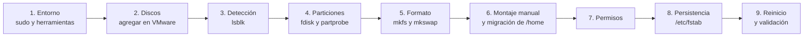
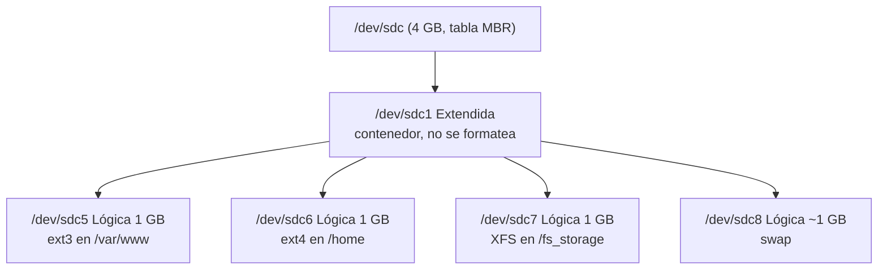

# Linux SysAdmin Fundamentals: Block Storage & Mount Workshop


-0A66C2?style=for-the-badge)


Armé este laboratorio para practicar lo que hacemos el primer día que nos entregan un servidor Linux con discos nuevos: detectarlos, particionarlos, darles formato, montarlos y asegurarnos de que sigan ahí después de un reinicio. Todo se hace desde la terminal, sobre una máquina virtual que se puede destruir y rehacer sin consecuencias.

## Qué es y para qué sirve

Trabajamos sobre un disco virtual de 4 GB (`/dev/sdc`). Dentro creamos una partición extendida y cuatro particiones lógicas de 1 GB cada una. Cada partición recibe un formato distinto y un destino distinto:

| Partición   | Tipo lógico | Formato | Destino       | Para qué sirve en el laboratorio                          |
|-------------|-------------|---------|---------------|-----------------------------------------------------------|
| `/dev/sdc5` | Lógica 1    | ext3    | `/var/www`    | Ver un filesystem con journal clásico                     |
| `/dev/sdc6` | Lógica 2    | ext4    | `/home`       | Migrar un directorio que ya tiene datos a otro disco      |
| `/dev/sdc7` | Lógica 3    | XFS     | `/fs_storage` | Conocer el filesystem por defecto en distribuciones enterprise |
| `/dev/sdc8` | Lógica 4    | swap    | (sin ruta)    | Activar memoria de intercambio en una partición dedicada  |

Al terminar vas a saber:

- Verificar privilegios y dejar instaladas las herramientas de formateo antes de tocar un disco.
- Identificar un disco nuevo sin confundirlo con el disco del sistema.
- Explicar por qué en MBR las particiones lógicas se numeran desde el 5.
- Crear particiones con `fdisk` y avisarle al kernel con `partprobe`.
- Formatear con `mkfs.ext3`, `mkfs.ext4`, `mkfs.xfs` y `mkswap`.
- Montar a mano, migrar datos existentes y dejar el montaje permanente en `/etc/fstab` usando UUID.
- Comprobar la persistencia con un reinicio real.

## Prerequisites

| Requisito | Detalle |
|-----------|---------|
| Hipervisor | VMware Workstation Pro o Player, con permiso para editar la configuración de la VM |
| Sistema invitado | Ubuntu 24.04 LTS (Desktop o Server), con acceso a terminal |
| Usuario | Cuenta con `sudo`. Lo verificamos en la fase 1 |
| Espacio en el host | Al menos 8 GB libres para los dos discos virtuales de 4 GB |
| Red | Conexión a internet desde la VM para instalar paquetes con `apt` |
| Conocimientos previos | Moverse por la terminal (`cd`, `ls`, editar un archivo con `nano`). Nada más |

Antes de empezar, toma un snapshot de la VM. Es la forma más rápida de repetir el laboratorio las veces que haga falta.

## Estructura de directorios del repositorio

```text
.
├── README.md      Esta guía: alcance, prerequisitos, flujo y cómo repetir el laboratorio
└── runbook.md     Ejecución paso a paso, de la preparación a la verificación final
```

El repositorio es deliberadamente pequeño. Los comandos no viven en scripts sino en el runbook, porque el objetivo es que cada persona los escriba, los lea y entienda qué hace cada uno.

## Vista general del flujo

El laboratorio avanza de lo más simple a lo más delicado. Primero solo leemos información del sistema, después modificamos el disco, y al final tocamos `/etc/fstab`, que es donde un error puede impedir que el sistema arranque.



Y así queda el disco al terminar la fase 4:



## Cómo se usa el runbook.md

El `runbook.md` se sigue de arriba hacia abajo, sin saltar fases. Cada fase tiene la misma forma:

1. **Objetivo**: qué vamos a lograr y por qué lo hacemos en ese punto.
2. **Comandos**: el texto exacto que se escribe, con el directorio donde se ejecuta y el archivo que toca.
3. **Explicación**: qué hace cada comando, cada opción y cada archivo involucrado.
4. **Verificación**: la salida que esperamos ver. Si no coincide, no pasamos a la fase siguiente.

Como instructor, mi recomendación es detenerse en tres puntos donde la gente suele fallar:

- **Fase 3**: confirmar que el disco vacío es `/dev/sdc` y no otro. Todo lo demás se ejecuta sobre ese nombre.
- **Fase 4**: la cuarta partición lógica no cabe como `+1G` exacto por el espacio que consumen las estructuras internas del MBR. El runbook explica qué responder.
- **Fase 8**: `/etc/fstab` se respalda antes de editarlo y se prueba con `mount -a` antes de reiniciar.

## Cómo destruir y volver a reproducir el laboratorio

Hay dos caminos. Usa el primero si quieres ahorrar tiempo y el segundo si quieres practicar la limpieza.

**Camino rápido: volver al snapshot.** Apaga la VM, revierte al snapshot que tomaste antes de la fase 2 y enciéndela. Queda exactamente como antes de empezar, incluidos `/etc/fstab` y `/home`.

**Camino manual: desmontar y limpiar.** El runbook cierra con una fase de limpieza que desactiva la swap, desmonta los tres directorios, restaura `/etc/fstab` desde su respaldo y borra las firmas de `/dev/sdc`. Después puedes volver a ejecutar desde la fase 4 sin agregar discos nuevos.

En ambos casos, el laboratorio es reproducible porque no depende de nada fuera de la VM.

## Alcance

Este laboratorio usa particionado MBR con particiones lógicas a propósito: es la forma de ver la jerarquía primaria, extendida y lógica. En servidores nuevos lo habitual es GPT, que no tiene esa limitación de cuatro entradas, y sobre él se suele agregar LVM. Eso queda como siguiente laboratorio.

