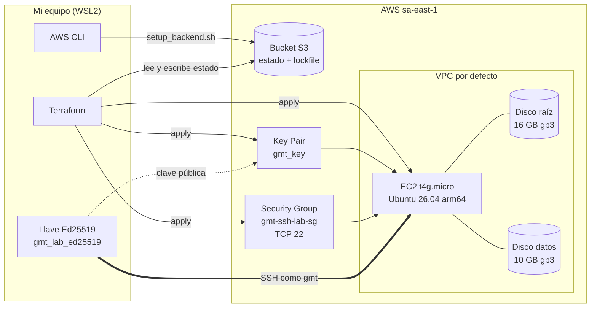

# Laboratorio AWS EC2 con Terraform: Ubuntu 26.04 LTS sobre Graviton2


Este repositorio es mi laboratorio de administración Linux sobre AWS. Lo armé para que cualquiera, yo mismo dentro de seis meses o un alumno que lo ve por primera vez, pueda levantar un servidor completo, entrar a él, trabajar y dejar la cuenta de AWS exactamente como estaba antes, sin facturas sorpresa.

Todo se hace con código. No hay clics en la consola web. Si algo funciona, queda escrito; si algo se rompe, se destruye y se vuelve a crear en minutos.

## Índice

1. [Qué es y para qué sirve](#1-qué-es-y-para-qué-sirve)
2. [Qué se despliega](#2-qué-se-despliega)
3. [Prerequisites](#3-prerequisites)
4. [Estructura de directorios](#4-estructura-de-directorios)
5. [Vista general del flujo](#5-vista-general-del-flujo)
6. [Cómo se usa el runbook](#6-cómo-se-usa-el-runbook)
7. [Destruir y reproducir el laboratorio](#7-destruir-y-reproducir-el-laboratorio)
8. [Costos y seguridad](#8-costos-y-seguridad)

---

## 1. Qué es y para qué sirve

El laboratorio levanta una máquina virtual (instancia EC2) con Ubuntu Server 26.04 LTS sobre procesador ARM Graviton2, con un disco adicional para practicar administración de almacenamiento, un usuario administrador propio y acceso por SSH con llave.

Lo que se aprende al recorrerlo, de lo más simple a lo más complejo:

1. Preparar un entorno de trabajo (WSL2, AWS CLI, Terraform) y comprobar que las credenciales funcionan.
2. Generar y proteger una llave SSH.
3. Crear un backend remoto en S3 para que el estado de Terraform no viva solo en mi computador.
4. Escribir, validar y planificar infraestructura como código.
5. Desplegar y conectarse por SSH a un servidor real.
6. Verificar desde adentro: usuario, `sudo`, versión del sistema operativo y discos.
7. Destruir todo en el orden correcto y auditar la cuenta para confirmar que no quedó nada cobrando.

Cada paso depende del anterior. Por eso el orden del runbook no es negociable.

## 2. Qué se despliega

| Componente | Detalle |
| :--- | :--- |
| Región | `sa-east-1` (São Paulo), la más cercana a Santiago de Chile |
| Cuenta AWS | `<ACCOUNT_ID>` |
| Cómputo | `aws_instance.lab_node`, tipo `t4g.micro` por defecto, Ubuntu 26.04 LTS `arm64`, IP pública, IMDSv2 obligatorio (`http_tokens = "required"`) |
| AMI | Se busca con el patrón `ubuntu/images/hvm-ssd-gp3/ubuntu-*-26.04-arm64-server-*`, propietario `099720109477` (Canonical) |
| Disco raíz | 16 GB `gp3`, cifrado, se elimina junto con la instancia |
| Disco de datos | 10 GB `gp3`, cifrado, adjunto en `/dev/sdf`; dentro de la máquina aparece como `/dev/nvme1n1` |
| Usuario | `gmt`, con `sudo` sin contraseña (`NOPASSWD:ALL`), entra con la llave `~/.ssh/gmt_lab_ed25519` |
| Red | VPC por defecto, Security Group `gmt-ssh-lab-sg` con entrada TCP 22 y salida total |
| Estado de Terraform | Bucket S3 `tfstate-lab-gmt-<ACCOUNT_ID>-sa-east-1`, versionado, cifrado `AES256`, acceso público bloqueado, bloqueo nativo con `use_lockfile = true` (sin DynamoDB) |
| Etiquetas | `Environment=lab`, `Project=sre-linux-lab`, `Owner=gmt`, `CostCenter=engineering-labs`, `ManagedBy=terraform`, `Workload=ubuntu-2604-graviton2` |

### Arquitectura

El diagrama muestra qué recurso depende de cuál y dónde vive el estado. Sirve para entender por qué el bucket tiene que existir antes que la instancia y desaparecer después.



## 3. Prerequisites

Antes de tocar nada, tienes que cumplir lo siguiente. Si algo falla aquí, todo lo demás falla más adelante y el error será menos claro.

| Requisito | Versión o condición | Cómo lo compruebo |
| :--- | :--- | :--- |
| Entorno de trabajo | WSL2 con Ubuntu Server 24.04 LTS (probado así) | `lsb_release -a` |
| Terraform | `>= 1.10.0` (necesario para `use_lockfile`) | `terraform version` |
| AWS CLI | v2, ya autenticado | `aws sts get-caller-identity` |
| Cliente SSH | OpenSSH | `ssh -V` |
| Permisos en AWS | Crear y borrar EC2, EBS, Security Groups, Key Pairs y buckets S3 | Lo confirma el propio despliegue |
| Cuenta de AWS | La del laboratorio, `<ACCOUNT_ID>` | Campo `Account` de `get-caller-identity` |
| Salida a internet | Para descargar providers y hablar con AWS | `curl -I https://registry.terraform.io` |

Los pasos de instalación y verificación están en la Fase 0 del runbook.

## 4. Estructura de directorios

El proyecto vive en `/home/gmt/lab-aws-ec2-clase4`. Todos los comandos del runbook se ejecutan desde ahí, salvo que diga lo contrario.

```text
lab-aws-ec2-clase4/
├── README.md          Este documento: qué es el laboratorio y cómo se recorre
├── runbook.md         Guía operativa fase por fase, con cada comando explicado
├── setup_backend.sh   Crea o verifica el bucket S3 y genera backend.hcl
├── backend.hcl        Parámetros del backend remoto (se genera, no se escribe a mano)
├── versions.tf        Versión mínima de Terraform, providers y declaración backend "s3" {}
├── variables.tf       Variables configurables y mapa obligatorio finops_tags
├── main.tf            Provider, AMI, key pair, red, cloud-init, EC2 y disco adicional
├── outputs.tf         Datos de salida: instance_id, public_ip, ssh_command, extra_ebs_volume_id
├── cleanup_all.sh     Limpieza total: destruye, vacía y borra el bucket, borra archivos locales
├── audit_aws.sh       Auditoría de residuos en sa-east-1
└── .terraform/        Lo crea terraform init (providers descargados, enlace al backend)
```

Y fuera del repositorio, pero necesarios:

```text
~/.ssh/
├── gmt_lab_ed25519       Llave privada, permisos 600. Nunca se sube a ningún repositorio.
└── gmt_lab_ed25519.pub   Llave pública, permisos 644. Es la que se registra en AWS.
```

### Qué hace cada archivo

| Archivo | Qué configura |
| :--- | :--- |
| `setup_backend.sh` | Script idempotente: lo puedo correr cuantas veces quiera. Crea `tfstate-lab-gmt-<ACCOUNT_ID>-sa-east-1`, activa versionado, bloquea acceso público, aplica cifrado `AES256` y escribe `backend.hcl`. |
| `backend.hcl` | Contiene `bucket`, `key`, `region`, `encrypt = true` y `use_lockfile = true`. Se pasa a `terraform init`. |

