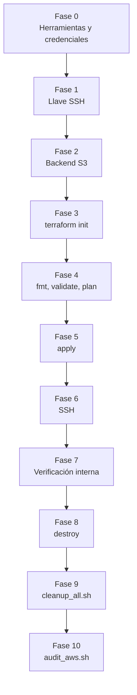
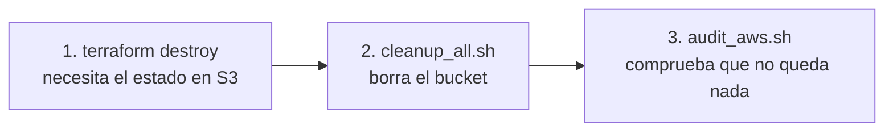

# Runbook operativo: despliegue, verificación, limpieza y auditoría


Esta es la guía que sigo para recorrer el laboratorio de principio a fin. Entorno donde lo probé: **WSL2 con Ubuntu Server 24.04 LTS**, directorio de trabajo `/home/gmt/lab-aws-ec2-clase4`, AWS CLI autenticado y Terraform `>= 1.10.0`.

Se sigue en orden. Cada fase termina con una verificación, y si esa verificación no da lo esperado, me detengo ahí antes de continuar.

## Orden de las fases



## Índice

* [Convenciones de este documento](#convenciones-de-este-documento)
* [Fase 0. Preparar herramientas y credenciales](#fase-0-preparar-herramientas-y-credenciales)
* [Fase 1. Llave SSH](#fase-1-llave-ssh)
* [Fase 2. Backend remoto en S3](#fase-2-backend-remoto-en-s3)
* [Fase 3. Inicializar Terraform](#fase-3-inicializar-terraform)
* [Fase 4. Formatear, validar y planificar](#fase-4-formatear-validar-y-planificar)
* [Fase 5. Aplicar la infraestructura](#fase-5-aplicar-la-infraestructura)
* [Fase 6. Acceder por SSH](#fase-6-acceder-por-ssh)
* [Fase 7. Verificar el servidor por dentro](#fase-7-verificar-el-servidor-por-dentro)
* [Fase 8. Destruir la infraestructura](#fase-8-destruir-la-infraestructura)
* [Fase 9. Limpiar backend y archivos locales](#fase-9-limpiar-backend-y-archivos-locales)
* [Fase 10. Auditar la cuenta](#fase-10-auditar-la-cuenta)
* [Apéndice A. Cambiar variables](#apéndice-a-cambiar-variables)
* [Apéndice B. Disco de datos sin montar](#apéndice-b-disco-de-datos-sin-montar)
* [Apéndice C. Problemas frecuentes](#apéndice-c-problemas-frecuentes)

## Convenciones de este documento

* Los comandos van en bloques `bash`. Se copian tal cual.
* Cuando el comando se ejecuta dentro del servidor remoto, lo indico con el título "En el servidor".
* Todo lo demás se ejecuta en mi WSL, dentro de `/home/gmt/lab-aws-ec2-clase4`.
* `\` al final de una línea significa que el comando continúa en la siguiente.
* `${VARIABLE}` es una variable de shell que se reemplaza por su valor al ejecutar.

---

## Fase 0. Preparar herramientas y credenciales

**Objetivo.** Confirmar que mi WSL tiene lo necesario y que AWS me reconoce. Es la fase más aburrida y la que más tiempo ahorra: casi todos los errores raros que aparecen más adelante nacen de una credencial vencida o una versión vieja.

**Directorio.** Cualquiera. Todavía no uso archivos del proyecto.

### 0.1 Confirmar el sistema y la arquitectura

```bash
lsb_release -a
uname -m
```

* `lsb_release -a` muestra la distribución y versión. Espero Ubuntu 24.04.
* `uname -m` muestra la arquitectura de **mi equipo**. Normalmente `x86_64`. Importa solo para elegir el instalador correcto del AWS CLI. No tiene relación con la arquitectura del servidor del laboratorio, que es `arm64` y se despliega en AWS.

### 0.2 Instalar Terraform (si no está)

```bash
terraform version
```

Si el comando no existe o la versión es menor a 1.10.0, instalo desde el repositorio oficial de HashiCorp:

```bash
sudo apt-get update
sudo apt-get install -y gnupg software-properties-common curl unzip
curl -fsSL https://apt.releases.hashicorp.com/gpg | \
  sudo gpg --dearmor -o /usr/share/keyrings/hashicorp-archive-keyring.gpg
echo "deb [signed-by=/usr/share/keyrings/hashicorp-archive-keyring.gpg] https://apt.releases.hashicorp.com $(lsb_release -cs) main" | \
  sudo tee /etc/apt/sources.list.d/hashicorp.list
sudo apt-get update
sudo apt-get install -y terraform
terraform version
```

* `apt-get update` refresca la lista de paquetes disponibles.
* `apt-get install -y ...` instala herramientas auxiliares; `-y` responde "sí" automáticamente.
* `curl -fsSL` descarga la clave de firma de HashiCorp: `-f` falla si hay error HTTP, `-s` silencioso, `-S` muestra errores aun en modo silencioso, `-L` sigue redirecciones.
* `gpg --dearmor -o ...` convierte la clave a formato binario y la guarda en `/usr/share/keyrings/`.
* La línea `echo "deb ..."` escribe en `/etc/apt/sources.list.d/hashicorp.list` la dirección del repositorio, indicando con `signed-by` qué clave lo valida. `lsb_release -cs` imprime el nombre en clave de mi Ubuntu (por ejemplo `noble`).
* `tee` escribe el archivo con permisos de administrador (un simple `>` no funcionaría con `sudo` delante del `echo`).

**Verificación.** `terraform version` imprime `Terraform v1.10.x` o superior. La versión mínima es obligatoria porque `use_lockfile` no existe antes de 1.10.

### 0.3 Instalar AWS CLI v2 (si no está)

```bash
aws --version
```

Si no existe:

```bash
cd /tmp
curl -fsSL "https://awscli.amazonaws.com/awscli-exe-linux-x86_64.zip" -o awscliv2.zip
unzip -q awscliv2.zip
sudo ./aws/install
aws --version
```

* Esta URL es para `x86_64`. Si `uname -m` dijo `aarch64`, cambio `x86_64` por `aarch64` en la URL.
* `-o awscliv2.zip` guarda la descarga con ese nombre. `unzip -q` descomprime sin imprimir cada archivo.
* `sudo ./aws/install` instala en `/usr/local/aws-cli` y deja el comando `aws` en el PATH.

**Verificación.** `aws --version` empieza con `aws-cli/2.`.

### 0.4 Autenticar y comprobar la cuenta

```bash
aws sts get-caller-identity
```

* `sts get-caller-identity` pregunta a AWS quién soy según las credenciales configuradas. No crea nada ni cuesta dinero.

**Verificación.** La respuesta JSON debe mostrar `"Account": "<ACCOUNT_ID>"`. Si muestra otra cuenta, me detengo: todo lo que sigue se crearía en el lugar equivocado. Si da error de credenciales, las configuro con `aws configure` (o mi método habitual, como SSO) y repito.

### 0.5 Verificar cliente SSH y salida a internet

```bash
ssh -V
curl -sI https://registry.terraform.io | head -n 1
```

* `ssh -V` imprime la versión de OpenSSH.
* `curl -sI` pide solo las cabeceras (`-I`) en silencio (`-s`); `head -n 1` se queda con la primera línea. Espero un `HTTP/2 200` o similar.

### 0.6 Entrar al directorio del proyecto

```bash
cd /home/gmt/lab-aws-ec2-clase4
ls -la
```

* `ls -la` lista todo, incluidos archivos ocultos (`-a`), en formato largo (`-l`). Debo ver `setup_backend.sh`, `cleanup_all.sh`, `audit_aws.sh`, `versions.tf`, `variables.tf`, `main.tf` y `outputs.tf`.

---

## Fase 1. Llave SSH

**Objetivo.** Tener un par de llaves Ed25519. La **pública** se registra en AWS y se inyecta en el servidor. La **privada** se queda conmigo y es lo único que me permite entrar. Sin contraseña de usuario, la llave es la única puerta.

**Directorio.** Cualquiera (usa rutas absolutas bajo `~/.ssh`).

```bash
ls -la ~/.ssh/gmt_lab_ed25519 ~/.ssh/gmt_lab_ed25519.pub || \
  ssh-keygen -t ed25519 -f ~/.ssh/gmt_lab_ed25519 -N "" -C "gmt-lab"
chmod 600 ~/.ssh/gmt_lab_ed25519
chmod 644 ~/.ssh/gmt_lab_ed25519.pub
```

**Qué hace, pieza por pieza.**

* `ls -la <archivos>` pregunta si ya existen las dos llaves. Si existen, imprime sus datos y el comando termina bien.
* `||` significa "si lo anterior falló, ejecuta lo siguiente". Así genero la llave solo cuando no existe y nunca sobrescribo una que ya uso.
* `ssh-keygen` crea el par de llaves:
  * `-t ed25519` elige el algoritmo moderno, corto y rápido.
  * `-f ~/.ssh/gmt_lab_ed25519` define el nombre del archivo de la privada. La pública se llama igual con `.pub`.
  * `-N ""` establece una frase de contraseña vacía. Es cómodo para un laboratorio; en producción lo correcto es proteger la llave con una frase.
  * `-C "gmt-lab"` agrega un comentario identificador dentro de la llave pública.
* `chmod 600` deja la privada legible solo por mí. SSH se niega a usar una llave privada con permisos más abiertos.
* `chmod 644` deja la pública legible por todos y escribible solo por mí, que es lo normal para un archivo que se puede compartir.

**Verificación.**

```bash
ssh-keygen -lf ~/.ssh/gmt_lab_ed25519
```

* `-l` muestra la huella (fingerprint) y `-f` indica de qué archivo. Debe imprimir una línea que termine en `(ED25519)`.

---

## Fase 2. Backend remoto en S3

**Objetivo.** Crear el lugar donde Terraform guardará su estado. El estado es el archivo donde Terraform anota qué recursos creó. Si vive solo en mi disco y lo pierdo, Terraform olvida lo que construyó y no puede destruirlo. Por eso lo guardo en S3, con versionado (puedo recuperar versiones anteriores) y con bloqueo (dos personas no pueden aplicar a la vez).

**Directorio.** `/home/gmt/lab-aws-ec2-clase4`

```bash
cd /home/gmt/lab-aws-ec2-clase4
chmod +x setup_backend.sh cleanup_all.sh audit_aws.sh
./setup_backend.sh
```

**Qué hace, pieza por pieza.**

* `cd` entra al directorio del proyecto. Todos los archivos relativos que siguen dependen de estar aquí.
* `chmod +x` da permiso de ejecución a los tres scripts. Sin él, `./setup_backend.sh` responde `Permission denied`.
* `./setup_backend.sh` ejecuta el script (el `./` indica "el que está en este directorio"). Es idempotente: si el bucket ya existe, lo verifica y no falla. Hace cinco cosas:
  1. Crea o verifica el bucket `tfstate-lab-gmt-<ACCOUNT_ID>-sa-east-1` en `sa-east-1`. El nombre incluye el ID de cuenta porque los nombres de bucket son únicos a nivel mundial.
  2. Activa el versionado.
  3. Bloquea todo acceso público.
  4. Aplica cifrado `AES256`.
  5. Genera el archivo `backend.hcl`.

**El archivo `backend.hcl`.** Contiene los parámetros que el bloque `backend "s3" {}` de `versions.tf` deja vacíos a propósito:

| Parámetro | Para qué sirve |
| :--- | :--- |
| `bucket` | Nombre del bucket donde se guarda el estado |
| `key` | Ruta del archivo de estado dentro del bucket |
| `region` | Región del bucket (`sa-east-1`) |
| `encrypt = true` | Cifra el estado al guardarlo |
| `use_lockfile = true` | Bloqueo nativo en S3 con un archivo `.tflock`, sin tabla DynamoDB |

Separar estos valores del código permite reusar el mismo `versions.tf` en otro bucket o cuenta sin editarlo.

**Verificación.**

```bash
cat backend.hcl
aws s3api head-bucket --bucket tfstate-lab-gmt-<ACCOUNT_ID>-sa-east-1 --region sa-east-1 && echo "BUCKET OK"
aws s3api get-bucket-versioning --bucket tfstate-lab-gmt-<ACCOUNT_ID>-sa-east-1 --region sa-east-1
```

* `cat` imprime el contenido de `backend.hcl`.
* `head-bucket` solo pregunta si el bucket existe y si tengo acceso; no devuelve datos. Si sale bien, `&&` ejecuta el `echo`.
* `get-bucket-versioning` debe responder `"Status": "Enabled"`.

---

## Fase 3. Inicializar Terraform

**Objetivo.** Preparar el directorio para trabajar: descargar los providers y conectar Terraform con el backend remoto.

**Directorio.** `/home/gmt/lab-aws-ec2-clase4`

```bash
terraform init -backend-config=backend.hcl
```

**Qué hace, pieza por pieza.**

* `terraform init` es siempre el primer comando en un directorio nuevo. Lee `versions.tf` y:
  * Descarga los providers `hashicorp/aws` (`~> 6.0`), `hashicorp/tls` (`~> 4.0`) y `hashicorp/local` (`~> 2.5`) y los guarda en el directorio oculto `.terraform/`.
  * Crea el archivo `.terraform.lock.hcl`, que fija las versiones exactas descargadas para que todos usen las mismas.
  * Configura el backend S3.
* `-backend-config=backend.hcl` le entrega los valores del backend desde ese archivo, que completan el bloque vacío de `versions.tf`.

**Verificación.** Debe terminar con:

```text
Terraform has been successfully initialized!
```

Y debe haber mencionado `Successfully configured the backend "s3"`. Si falla con un error de acceso al bucket, repito la Fase 0.4 (credenciales) y la Fase 2.

---

## Fase 4. Formatear, validar y planificar

**Objetivo.** Revisar el código antes de gastar un centavo. Son tres comprobaciones de menor a mayor profundidad: estilo, sintaxis y consistencia, y simulación contra AWS.

**Directorio.** `/home/gmt/lab-aws-ec2-clase4`

```bash
terraform fmt
terraform validate
terraform plan
```

**Qué hace cada uno.**

* `terraform fmt` reescribe los archivos `.tf` con el formato estándar (sangría, alineación). Imprime los nombres de los archivos que modificó; si no imprime nada, ya estaban bien. No cambia el comportamiento.
* `terraform validate` revisa que la configuración sea válida: sintaxis, nombres de variables y referencias entre recursos. No habla con AWS.
* `terraform plan` compara lo que declara mi código con el estado guardado en S3 y con la realidad en AWS, y muestra qué haría. **No crea nada.**

**Verificación.**

* `validate` debe decir `Success! The configuration is valid.`
* `plan` debe listar recursos a crear con el prefijo `+`. Espero ver:
  * la instancia Graviton2 (`t4g.micro`),
  * el volumen EBS adicional de 10 GB `gp3` y su adjunto,
  * el Security Group `gmt-ssh-lab-sg`,
  * el Key Pair `gmt_key`.
* El plan termina con una línea como `Plan: N to add, 0 to change, 0 to destroy.` Mientras sea la primera vez, `change` y `destroy` deben ser 0. Si aparece algo para destruir, paro y reviso por qué.

---

## Fase 5. Aplicar la infraestructura

**Objetivo.** Crear los recursos reales en AWS. A partir de aquí hay cobro por hora.

**Directorio.** `/home/gmt/lab-aws-ec2-clase4`

```bash
terraform apply -auto-approve
```

**Qué hace, pieza por pieza.**

* `terraform apply` ejecuta el plan: crea los recursos en el orden que dicta el grafo de dependencias (la llave y el Security Group antes que la instancia, la instancia antes que el adjunto del disco).
* `-auto-approve` omite la pregunta interactiva `Do you want to perform these actions?`. En un laboratorio ahorra tiempo; en un entorno real conviene correr `plan`, leerlo y aprobar a mano.
* Durante el `apply`, `main.tf` entrega a la instancia un script `cloud-init` que, en el primer arranque:
  * crea el usuario `gmt`,
  * le da `sudo` sin contraseña (`NOPASSWD:ALL`),
  * instala mi llave pública en su `authorized_keys`,
  * ejecuta `runcmd`, que enmascara `systemd-networkd-wait-online.service` para evitar que el arranque se quede esperando red.
* Al terminar, `outputs.tf` imprime:

| Output | Qué es |
| :--- | :--- |
| `instance_id` | Identificador de la instancia (`i-...`) |
| `public_ip` | IP pública para conectarme |
| `ssh_command` | Comando SSH ya armado con la llave correcta |
| `extra_ebs_volume_id` | Identificador del disco de 10 GB (`vol-...`) |

**Verificación.** Debe terminar con `Apply complete! Resources: N added, 0 changed, 0 destroyed.` y mostrar los cuatro outputs. Puedo volver a verlos cuando quiera con:

```bash
terraform output
```

Que "Apply complete" aparezca no significa que el servidor ya esté listo para recibir SSH: la instancia existe, pero `cloud-init` aún puede estar trabajando. De eso se encarga la fase siguiente.

---

## Fase 6. Acceder por SSH

**Objetivo.** Entrar al servidor como `gmt`. Primero espero a que el puerto 22 responda, porque conectarme demasiado pronto da `Connection refused` o `Connection timed out` y no significa que algo esté mal.

**Directorio.** `/home/gmt/lab-aws-ec2-clase4` (para que `terraform output` encuentre el estado).

```bash
IP=$(terraform output -raw public_ip)
for i in $(seq 1 30); do
  if timeout 3 bash -c "</dev/tcp/${IP}/22" 2>/dev/null; then
    echo "PUERTO 22 LISTO EN ${IP}"
    break
  fi
  sleep 3
done
ssh -o ConnectTimeout=8 -o StrictHostKeyChecking=accept-new -i ~/.ssh/gmt_lab_ed25519 "gmt@${IP}"
```

**Qué hace, línea por línea.**

* `IP=$(terraform output -raw public_ip)` ejecuta `terraform output` y guarda el resultado en la variable `IP`. `-raw` imprime el valor sin comillas, que es lo que necesito para usarlo en otros comandos.
* `for i in $(seq 1 30); do ... done` repite hasta 30 veces. `seq 1 30` genera los números del 1 al 30.
* `timeout 3 bash -c "</dev/tcp/${IP}/22"` intenta abrir una conexión TCP al puerto 22 durante máximo 3 segundos. `/dev/tcp/IP/PUERTO` es una función propia de bash que abre un socket sin necesitar herramientas externas como `nc`.
* `2>/dev/null` descarta los mensajes de error para que el bucle no llene la pantalla.
* Si la conexión funciona, imprime el aviso y `break` sale del bucle. Si no, `sleep 3` espera 3 segundos y reintenta. En total espero hasta unos 90 segundos.
* `ssh` abre la sesión:
  * `-o ConnectTimeout=8` limita a 8 segundos el intento de conexión.
  * `-o StrictHostKeyChecking=accept-new` acepta y guarda la huella del servidor la primera vez que lo veo (sin preguntar), pero rechaza la conexión si la huella cambia después. Es un punto medio razonable entre comodidad y seguridad.
  * `-i ~/.ssh/gmt_lab_ed25519` indica qué llave privada usar.
  * `"gmt@${IP}"` es usuario y destino.

Puedo llegar al mismo resultado con `terraform output -raw ssh_command`, que imprime el comando ya armado.

**Verificación.** Aparece el prompt `gmt@ip-...:~$`. Si el bucle termina sin imprimir "PUERTO 22 LISTO", espero un minuto más y repito; si persiste, voy al Apéndice C.

---

## Fase 7. Verificar el servidor por dentro

**Objetivo.** Comprobar que lo que Terraform declaró es lo que realmente quedó funcionando: usuario, privilegios, sistema operativo y discos.

**En el servidor** (ya dentro de la sesión SSH):

```bash
whoami
sudo -n true && echo "SUDO_OK"
cat /etc/os-release | head -n 3
uname -m
lsblk -o NAME,SIZE,TYPE,MOUNTPOINTS
df -hT
```

**Qué hace cada comando y qué espero ver.**

| Comando | Qué hace | Resultado esperado |
| :--- | :--- | :--- |
| `whoami` | Imprime el usuario actual | `gmt` |
| `sudo -n true && echo "SUDO_OK"` | `-n` (non-interactive) hace que `sudo` falle en vez de pedir contraseña; `true` es un comando que no hace nada. Si `sudo` pasa sin pedir clave, se imprime el aviso | `SUDO_OK` |
| `cat /etc/os-release \| head -n 3` | Muestra los datos de la distribución y se queda con las tres primeras líneas | `PRETTY_NAME` con Ubuntu 26.04 |
| `uname -m` | Arquitectura del procesador del servidor | `aarch64` (es el nombre que usa Linux para arm64) |
| `lsblk -o NAME,SIZE,TYPE,MOUNTPOINTS` | Lista los dispositivos de bloque, con las columnas que pedí | Disco raíz de 16G y `nvme1n1` de 10G |
| `df -hT` | Espacio usado por sistema de archivos: `-h` en unidades legibles, `-T` agrega el tipo | La raíz `/` y, si está montado, el volumen de datos |

Sobre los nombres de disco: en Terraform adjunté el volumen como `/dev/sdf`, pero las instancias Graviton (sistema Nitro) presentan los discos EBS como dispositivos NVMe. Por eso, dentro del servidor, lo que declaré como `/dev/sdf` aparece como `/dev/nvme1n1` (y su partición, `/dev/nvme1n1p1`). Es el mismo disco con otro nombre.

Si el disco de 10 GB aparece sin punto de montaje, el Apéndice B explica cómo montarlo a mano.

**Salir del servidor.** Cuando termino de trabajar:

```bash
exit
```

`exit` cierra la sesión SSH y me devuelve a mi WSL. Los siguientes comandos se ejecutan de nuevo en mi equipo, no en el servidor.

---

## Fase 8. Destruir la infraestructura

**Objetivo.** Eliminar la instancia, los discos, el Security Group y el Key Pair. Se hace **primero** y **mientras el bucket sigue existiendo**, porque Terraform necesita leer el estado para saber qué borrar.



**Directorio.** `/home/gmt/lab-aws-ec2-clase4`

```bash
cd /home/gmt/lab-aws-ec2-clase4
terraform destroy -auto-approve
```

**Qué hace.**

* `terraform destroy` lee el estado desde S3, calcula qué recursos existen y los elimina en el orden inverso al de creación (primero se desadjunta y borra lo que depende de la instancia, al final lo demás).
* `-auto-approve` omite la confirmación interactiva.
* El disco raíz se elimina con la instancia (`delete_on_termination = true`). El disco de datos es un recurso propio de Terraform y se elimina por separado.

**Verificación.** Termina con `Destroy complete! Resources: N destroyed.`

---

## Fase 9. Limpiar backend y archivos locales

**Objetivo.** Eliminar el bucket de estado y los archivos generados, de modo que la cuenta quede como antes de empezar.

**Directorio.** `/home/gmt/lab-aws-ec2-clase4`

```bash
./cleanup_all.sh
```

**Qué hace.** El script es idempotente (puedo correrlo aunque algo ya esté borrado) y ejecuta, en este orden:

1. Intenta `terraform destroy -auto-approve` por si algo quedó (no hace daño si ya no hay nada).
2. Vacía el bucket S3, incluyendo **todas las versiones** de objetos y los `DeleteMarkers`. Esto es necesario porque un bucket con versionado no se puede borrar mientras conserve versiones antiguas, aunque a simple vista parezca vacío.
3. Elimina el bucket `tfstate-lab-gmt-<ACCOUNT_ID>-sa-east-1`.
4. Borra los archivos locales generados (`backend.hcl`, el directorio `.terraform/`, estado local temporal).

**Verificación.** Debe imprimir:

```text
Limpieza completa sin residuos en AWS.
```

---

## Fase 10. Auditar la cuenta

**Objetivo.** Confirmar con datos, no con confianza, que no quedó nada que genere cobro.

**Directorio.** `/home/gmt/lab-aws-ec2-clase4`

```bash
./audit_aws.sh
```

Este es el script completo. Lo dejo aquí para tenerlo a mano si necesito recrearlo:

```bash
#!/usr/bin/env bash
set -euo pipefail

AWS_REGION="${AWS_REGION:-sa-east-1}"
ACCOUNT_ID="$(aws sts get-caller-identity --query Account --output text)"
BUCKET_NAME="${BUCKET_NAME:-tfstate-lab-gmt-${ACCOUNT_ID}-${AWS_REGION}}"

echo "=== Auditoría AWS en región: ${AWS_REGION} | Cuenta: ${ACCOUNT_ID} ==="

echo "[1/6] Instancias EC2 (pending, running, stopping, stopped):"
aws ec2 describe-instances \
  --region "${AWS_REGION}" \
  --filters "Name=instance-state-name,Values=pending,running,stopping,stopped" \
  --query "Reservations[*].Instances[*].{ID:InstanceId,Type:InstanceType,State:State.Name,IP:PublicIpAddress}" \
  --output table

echo "[2/6] Volúmenes EBS:"
aws ec2 describe-volumes \
  --region "${AWS_REGION}" \
  --query "Volumes[*].{VolumeId:VolumeId,SizeGiB:Size,Type:VolumeType,State:State}" \
  --output table

echo "[3/6] Snapshots EBS propios:"
aws ec2 describe-snapshots \
  --region "${AWS_REGION}" \
  --owner-ids self \
  --query "Snapshots[*].{SnapshotId:SnapshotId,VolumeId:VolumeId,SizeGiB:Size,State:State}" \
  --output table

echo "[4/6] Elastic IPs:"
aws ec2 describe-addresses \
  --region "${AWS_REGION}" \
  --query "Addresses[*].{PublicIp:PublicIp,AllocationId:AllocationId,InstanceId:InstanceId}" \
  --output table

echo "[5/6] Security Groups de laboratorio (gmt-ssh-lab-sg):"
aws ec2 describe-security-groups \
  --region "${AWS_REGION}" \
  --filters "Name=group-name,Values=gmt-ssh-lab-sg" \
  --query "SecurityGroups[*].{GroupId:GroupId,GroupName:GroupName,VpcId:VpcId}" \
  --output table

echo "[6/6] Bucket S3 del backend (${BUCKET_NAME}):"
if aws s3api head-bucket --bucket "${BUCKET_NAME}" --region "${AWS_REGION}" 2>/dev/null; then
  echo "ESTADO: Bucket ${BUCKET_NAME} EXISTE"
else
  echo "ESTADO: Bucket ${BUCKET_NAME} NO EXISTE (limpio)"
fi
```

**Cómo leer el script.**

* `#!/usr/bin/env bash` indica con qué intérprete se ejecuta.
* `set -euo pipefail` endurece el script: `-e` se detiene ante el primer error, `-u` falla si uso una variable sin definir, `-o pipefail` hace que un error dentro de una tubería (`|`) cuente como error.
* `${AWS_REGION:-sa-east-1}` usa el valor de la variable si existe y, si no, `sa-east-1`. Permite auditar otra región sin editar el script: `AWS_REGION=us-east-1 ./audit_aws.sh`.
* `--query` filtra la respuesta JSON con JMESPath y `--output table` la presenta como tabla legible.
* `--filters` pide a AWS que filtre antes de responder.
* Cada bloque revisa una categoría que puede cobrar sin que me dé cuenta:

| Paso | Qué revisa | Por qué importa |
| :--- | :--- | :--- |
| 1 | Instancias EC2 en cualquier estado activo | Una instancia detenida no cobra cómputo, pero conserva sus discos |
| 2 | Volúmenes EBS | Un disco sin adjuntar sigue cobrando por GB |
| 3 | Snapshots propios (`--owner-ids self`) | Cobran por GB y son fáciles de olvidar |
| 4 | Elastic IPs | Una IP elástica sin asociar cobra por hora |
| 5 | Security Group `gmt-ssh-lab-sg` | No cobra, pero es residuo de configuración |
| 6 | Bucket del backend | Revisa si el estado aún existe en S3 |

**Verificación.** Las cinco tablas deben salir vacías y la última línea debe decir `NO EXISTE (limpio)`. Si algo aparece, lo identifico y lo borro a mano, y vuelvo a correr la auditoría hasta que quede limpia.

---

## Apéndice A. Cambiar variables

Las variables se definen en `variables.tf`. Para cambiar un valor en una ejecución puntual, sin editar archivos, uso `-var`:

```bash
terraform plan  -var 'ssh_ingress_cidr=203.0.113.25/32'
terraform apply -var 'ssh_ingress_cidr=203.0.113.25/32' -auto-approve
```

| Variable | Qué controla | Ejemplo |
| :--- | :--- | :--- |
| `aws_region` | Región de despliegue | `sa-east-1` |
| `instance_type` | Tipo de instancia (debe ser Graviton, `arm64`) | `t4g.micro`, `t4g.small` |
| `admin_username` | Usuario administrador creado por cloud-init | `gmt` |
| `ssh_ingress_cidr` | Quién puede llegar al puerto 22 | `0.0.0.0/0` o mi IP con `/32` |
| `extra_ebs_size_gb` | Tamaño del disco de datos | `10` |

Para saber mi IP pública y restringir el acceso:

```bash
curl -s https://checkip.amazonaws.com
```

Con ese valor armo `ssh_ingress_cidr=<mi-ip>/32`. El `/32` significa "exactamente esta dirección".

Si cambio `instance_type` a uno x86 (por ejemplo `t3.micro`), la AMI `arm64` no arrancará. El laboratorio está diseñado para Graviton.

## Apéndice B. Disco de datos sin montar

Si en la Fase 7 `lsblk` muestra `nvme1n1` sin `MOUNTPOINTS`, puedo prepararlo a mano. **Antes de formatear, confirmo que el disco está vacío**: formatear borra todo su contenido.

**En el servidor:**

```bash
lsblk -f /dev/nvme1n1
```

Si la columna `FSTYPE` está vacía, el disco no tiene sistema de archivos y es seguro continuar:

```bash
sudo mkfs.ext4 /dev/nvme1n1
sudo mkdir -p /jj
sudo mount /dev/nvme1n1 /jj
df -hT /jj
```

* `lsblk -f` muestra el tipo de sistema de archivos de cada dispositivo.
* `mkfs.ext4` crea un sistema de archivos ext4 en el disco. Es la operación destructiva.
* `mkdir -p /jj` crea el punto de montaje; `-p` evita error si ya existe.
* `mount` conecta el disco al directorio `/jj`. Lo que escriba en `/jj` queda en el disco de 10 GB.
* `df -hT /jj` confirma tipo y tamaño.

Este montaje no sobrevive a un reinicio. Para hacerlo permanente se agrega una entrada en `/etc/fstab` usando el `UUID` que muestra `lsblk -f`, nunca el nombre `/dev/nvme1n1`, porque ese nombre puede cambiar entre arranques.

## Apéndice C. Problemas frecuentes

| Síntoma | Causa probable | Qué hago |
| :--- | :--- | :--- |
| `Permission denied` al ejecutar un script | Falta permiso de ejecución | `chmod +x setup_backend.sh cleanup_all.sh audit_aws.sh` |
| `terraform init` falla con acceso denegado al bucket | Credenciales vencidas o cuenta equivocada | `aws sts get-caller-identity` y reconfigurar |
| `Unsupported argument: use_lockfile` | Terraform menor a 1.10 | Actualizar Terraform (Fase 0.2) |
| `Error acquiring the state lock` | Otra ejecución en curso o una anterior interrumpida | Esperar; si estoy seguro de que no hay otra, `terraform force-unlock <ID>` |
| El bucle de la Fase 6 no ve el puerto 22 | La instancia aún arranca o el Security Group no permite mi IP | Esperar un minuto; revisar `ssh_ingress_cidr` |
| `Permission denied (publickey)` | Llave equivocada o permisos incorrectos | Confirmar `-i ~/.ssh/gmt_lab_ed25519` y `chmod 600` |
| `WARNING: REMOTE HOST IDENTIFICATION HAS CHANGED` | Nueva instancia con la misma IP | `ssh-keygen -R <IP>` y reconectar |
| `Unauthorized` o AMI no encontrada | Ubuntu 26.04 arm64 aún no publicada en la región | Verificar el patrón de la AMI y la región |
| `audit_aws.sh` lista un volumen o IP | Recurso que no gestionó Terraform | Identificarlo y eliminarlo a mano con el AWS CLI |
| El bucket no se puede borrar | Quedan versiones o `DeleteMarkers` | Volver a correr `./cleanup_all.sh` |

Una regla simple para cualquier duda: si no entiendo qué va a hacer un comando, corro primero el equivalente que no modifica nada (`plan`, `describe-...`, `ls`) y leo la salida antes de ejecutar la versión que sí cambia cosas.

